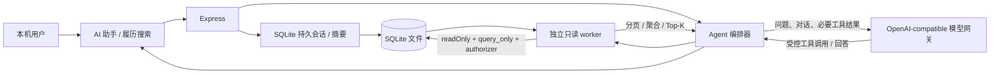

# Agent 安全边界

## 2026-09 检索执行边界增量（应用 0.2.0）

2026-09-10 用户进一步授权完成正式混合检索，作为 0.2.0 / V13 补充，包含既有网关的正式本人材料向量回填及持续维护。仅使用既有服务端配置，不连接新供应商、不迁移主库。正式索引维护属于授权业务处理，不用正式候选人数据做评测、浏览器截图或测试 fixture；所有正式运行记录仅含脱敏聚合。实际启用状态见 [补充交付](handoffs/2026-09-10-search-hybrid-formal-supplement.md)。

新人才检索使用独立只读 worker 和固定 SQL 编译器。模型只能返回由 Ajv 校验的查询计划，禁止客户端或模型提供 SQL。模型输入为查询文本，Embedding 输入仅为候选人主档选定字段、有效履历区块及已解析简历附件，重排最多50个、每个1800字符的本人证据包。关联职位/人才库和结构化来源 JSON 不作为本人技能证据。

远程适配器执行 DNS 校验与连接地址固定、TLS校验、禁止重定向、请求/响应体上限、超时/取消，错误不包含密钥、地址或上游正文。私网 HTTPS 仅使用已有明确的可信主机配置。维护 CLI 要求显式 `--formal` 或带标记的匿名库，正式模式仍要求源路径和独立输出目录；后台维护需远程开关、维护开关及向量目录同时配置。只读查询不写向量或迁移主库。

出站前用本地姓名/手机/邮箱字面量及联系方式、证件号、URL 和个人信息标签规则遮蔽本人材料；先遮蔽整段再切片，保留本地原文偏移。重排最多发送 50 个本人证据包，也执行身份遮蔽。规则遮蔽并不保证全文匿名，任职公司、教育、项目及正文中的未识别个人信息仍可能出站；网关费用、保留、训练和删除政策没有因此得到验证。查询本身也可能含用户输入的身份信息。正式索引保留原文、本地缓存与 active/previous 代际需按敏感本地文件保护；逻辑删除后的旧代际不参与检索，但不等于备份或磁盘块的密码学擦除。

新模块固定字段投影独立于通用 Agent 列政策。当前工作树已有 `storage_path` 列政策与旧安全文档不一致；2026-09-10在原工作树复现了相关测试失败，本增量未回滚用户的通用列政策修改，不能声称该旧边界已通过验收。

## 结论

V8 Agent 是 SQLite **业务全字段按需只读**查询层。按用户明确授权，它可以查询服务端业务政策目录内任何允许表和字段，包括未打码手机号/邮箱、证件照地址、薪资、求职偏好、备注、活动、完整履历、历史评估、授权、申请来源、`candidate_source_records.raw_payload`、附件解析正文、归档数据及候选人/职位最小删除审计。

“业务全字段”不等于无边界的 SQLite 文件读取。会话/消息/摘要、附件临时预览与清理任务、迁移账本、搜索文档/FTS shadow 等内部状态不进入普通 Agent schema 目录；附件物理 `storage_path` 和向量 BLOB 也被列政策及结果过滤隔离。服务端搜索工具可以使用内部 FTS 完成召回，但不能把这些内部表或受限列暴露给模型。

全字段可读不等于整库主动外发。数据库负责扫描全量记录、全文检索和聚合；模型只接收当前问题需要的分页、统计或 Top-K 结果。Agent 没有任何新增、修改、归档、恢复、关联、附件确认、永久删除、通用终端、任意文件访问或任意 HTTP 请求能力。

当前仍没有认证、RBAC、字段权限或租户隔离。该能力只能用于本机回环单用户版，不能直接部署为部门共享服务。

## 数据流



Agent 的业务查询不复用 Express 业务写连接，也不通过 `include_sensitive=true` 获取数据。每次 SQLite 查询在独立 worker 内打开文件型数据库；模型只看到工具 schema 和经过服务端限制的结果，不获得数据库路径、连接对象或文件句柄。会话服务使用普通业务连接写入自己的会话表，但它不是 Agent 工具，也不能借此修改候选人、职位或附件。

若 `AGENT_BASE_URL` 指向远程服务，用户问题、最近对话、未打码敏感字段和简历片段可能离开本机。启用前必须审查网关的日志、存储、训练使用、地域、访问控制和删除政策。

## 工具白名单

| 工具 | 用途 |
| --- | --- |
| `get_schema_catalog` | 读取实时表、视图、字段、类型和外键目录 |
| `execute_readonly_query` | 执行一条经 authorizer 验证的 `SELECT` 或只读 CTE |
| `query_candidates` | 目录驱动查询候选人全部字段 |
| `get_candidate_full` | 候选人主档及备注、活动、履历、偏好、来源、评估、授权、关系、附件和索引文档 |
| `query_candidate_notes` | 查询备注全文 |
| `query_candidate_activities` | 查询活动和元数据 |
| `query_candidate_sources` | 查询候选人来源与职位申请来源，包括 `raw_payload` |
| `query_candidate_assessments` | 查询历史评估全部字段和原始载荷 |
| `query_positions` | 查询职位全部字段和归档状态 |
| `get_position_full` | 职位主档、候选人关系、申请来源与相关评估 |
| `query_talent_pools` | 查询人才库全部字段和归档状态 |
| `aggregate_recruitment_data` | 由 SQLite 全量聚合、分组并只返回统计结果 |
| `search_all_records` | 跨候选人、职位、人才库、来源、附件和最小删除审计等实体检索全业务字段，按实体去重返回证据 |
| `search_candidate_resumes` | 结构化条件 + V8 全业务字段 FTS5 的候选人级 Top-K 检索 |
| `get_candidate_resume` | 分页读取候选人索引履历文档正文 |
| `query_candidate_attachments` | 查询附件元数据，不返回物理文件字节 |
| `get_attachment_text` | 按附件 ID 读取解析正文和元数据 |
| `export_query_results` | 用相同只读防护生成本地 CSV 明细 |

当前白名单共 18 个工具。未知工具名返回 `tool_not_allowed` / `tool_not_found`。工具列表不包含写操作、附件确认 API 或系统命令。

## SQLite 只读连接

worker 使用 Node.js 内置 `DatabaseSync`：

- 文件以 `readOnly: true` 打开；内存数据库不用于 Agent 只读服务测试，测试必须使用匿名临时文件型数据库。
- 设置 `PRAGMA query_only=ON`、`PRAGMA trusted_schema=OFF`、`temp_store=MEMORY`、`mmap_size=0` 和 64 MB `hard_heap_limit`。
- 启用 SQLite defensive mode，关闭双引号字符串字面量。
- 构造连接时 `allowExtension:false`，并再次调用 `enableLoadExtension(false)`；不能加载 SQLite 扩展。
- schema 目录只包括服务端显式业务表政策与 `main` 实际 schema 的交集，再用 `table_xinfo` 获取允许的非隐藏、非 BLOB 字段和外键；客户端不能把未分类内部表加入目录。

自由 SQL 的语句扫描器只负责引号/注释状态、单语句边界和首关键字，允许一条 `SELECT` 或 `WITH`。它不是最终安全判断。SQLite `setAuthorizer()` 在 prepare 阶段逐操作码执行真正授权：

- 允许 `SQLITE_SELECT`、递归只读 CTE、目录中已知表/字段的 `SQLITE_READ` 和显式安全函数集合。
- FTS5 内部只允许只读 `data_version` PRAGMA。
- 拒绝 `INSERT`、`UPDATE`、`DELETE`、`REPLACE`、DDL、写 PRAGMA、`ATTACH`、`DETACH`、事务控制、扩展加载、文件函数、未知表/列/函数及其他操作码。
- 多语句、注释绕过、CTE 写入、标识符注入和参数注入分别由单语句边界、authorizer、schema 目录和绑定参数阻断；不是只靠正则表达式。

普通 SQL 明确拒绝 `agent_sessions`、`agent_messages`、`agent_session_summaries`、`attachment_update_previews`、`attachment_cleanup_jobs`、`schema_migrations`、`search_documents_v2`、`search_documents_v2_fts` 及其 shadow 表、旧 `candidate_resume_fts`。`candidate_attachments.storage_path` 和 `candidate_resume_vectors.vector` 也不可直接或通过别名/CTE 返回。服务端拥有的搜索/兼容工具只能访问完成任务所需的内部 FTS，并在结果层再次移除物理路径和向量内容。

结构化查询的表、字段和 join 路径必须先在服务端 schema 目录解析，再由服务端引用并加引号。支持 `eq`、`ne`、`contains`、`in`、`gte`、`lte`、`is_null`、最多 12 个关联、8 个排序字段、分页、`count|sum|avg|min|max` 聚合和最多 12 个分组字段。客户端标识符不会未经目录校验直接拼入 SQL。

## 资源与上下文限制

| 限制 | 当前值 |
| --- | ---: |
| SQL 长度 | 50,000 字符 |
| 常规查询行数 | 最多 100 |
| 常规响应 | 最多 1,000,000 字节 |
| 默认 / 最大超时 | 3 秒 / 15 秒 |
| 页码 / 每页 | 最多 1000 / 100 |
| 筛选 / `in` 值 / 排序 | 50 / 100 / 8 |
| 参数数量 / 参数总字节 | 1000 / 1,000,000 |
| 本地 CSV 导出 | 最多 50,000 行 / 25,000,000 字节 |
| 单个模型工具结果封套 | 最多 500,000 字节 |
| 模型总上下文 | 最多 512 KiB |
| 单次问答总工具轮次 | 不设固定上限；按真实证据进展持续执行，同一批最多并发 4 个 |
| 无进展保护 | 语义参数指纹、结果证据去重、连续无新证据后收束；无成功工具证据不得完成 |
| 用户消息 / Agent 回复 | 20,000 / 120,000 字符 |
| 最近历史 | 最多 12 条 / 96 KiB |
| 摘要输入 / 摘要正文 | 最多 256 KiB / 16,000 字符 |
| 会话与消息 API 页大小 | 最多 100 |
| 会话请求锁陈旧阈值 | 2 分钟 |

查询可扫描全表完成筛选、排序或聚合，返回上限不限制数据库扫描范围。常规结果超限时返回 `has_more` / `limited_by`，要求缩小条件或翻页；完整结果使用 `export_query_results`，不把全部明细放进模型上下文。导出文件以独占创建和仅当前用户权限写入受控目录，并通过随机 ID 下载。

## 全业务字段 FTS5 与 Top-K

V8 保留 V6 `candidate_resume_documents` / `candidate_resume_fts` 供兼容读取，但候选人召回改由 `search_documents_v2` / `search_documents_v2_fts` 完成。服务端先显式列出业务表政策，再通过 `PRAGMA table_xinfo` 动态发现其全部非隐藏、非 BLOB 且未显式排除的字段。JSON 递归展开为稳定 `field_path`；长值按 4,000 Unicode code point 确定性分段且不截断；中文搜索文本补充二元/三元 token。

索引覆盖候选人、备注、活动、职位、人才库、关系、履历/偏好/来源/评估/授权/申请来源、附件文本和最小删除审计等政策业务数据。`candidate_attachments.storage_path`、向量 BLOB、Agent 会话内部表、附件预览/清理、迁移账本及搜索内部对象排除；`agent_query_audits` 可受控查询但不进入 FTS，避免查询审计自身持续使索引变脏。

检索流程为：

```text
自然语言问题
-> 结构化筛选 + 关键词/同义词
-> SQLite 结构化字段查询 + 全业务字段 FTS5 全库检索
-> 候选人级去重和排序
-> Top-K 候选人及必要片段
-> 模型回答
```

结果返回候选人 ID、BM25、来源表、字段路径、段坐标、实际命中词、同义词扩展标志、合并后的重叠高亮和可解释证据。职位、人才库、阶段或导入批次命中可映射到关联候选人，最终按候选人聚合去重。HTTP 检索每页最多 100；Agent 默认 20、最多 50 位候选人，每位最多 1 至 5 条 evidence，并通过总行/上下文限制控制模型输入。默认多概念路径仅为召回 Top-20 建立候选人范围关系子集，每个概念优先真实命中证据；该优化不扩大结果行数或模型上下文。查看更多必须翻页；全库统计必须由 SQLite 聚合。

`search_all_records` 使用同一索引按业务实体聚合结果，适合跨候选人、职位、人才库、来源、附件和最小删除审计定位记录；`search_candidate_resumes` 则把直接与关系映射命中聚合到候选人，用于候选人级 Top-K 召回。两者都只把当前页实体和必要证据返回 Agent。

政策业务表的 INSERT/UPDATE/DELETE trigger 将来源行幂等写入 `search_index_dirty_v2` 并把 checkpoint 标记为 pending。同步器在同一个业务写事务中删除旧文档、重建目标行、清理 dirty 项；最后一批完成后重算表级与字段级 coverage。首次 V8 打开数据库强制全量回填，后续启动只同步 dirty 项。FTS5 不可用或 checkpoint/coverage 未达到 ready 时返回明确错误，禁止静默改为读取全库正文并发送给模型。

现有模型网关只确认 Chat Completions，未确认 Embedding；V6 向量表仍仅作未来本地元数据预留，V8 向量检索关闭，未连接其他服务，也未安装本地大型模型、GPU 运行时或向量数据库。

## 持久会话与摘要边界

V8 把会话、消息和摘要保存在当前本机 SQLite，而不是 `localStorage`：

- `agent_sessions` 保存标题、活动/归档状态、消息序号和当前请求锁。
- `agent_messages` 保存用户/Agent 正文、`processing|completed|failed` 状态、模型、工具名和字节统计。
- `agent_session_summaries` 保存截至指定消息序号的压缩摘要。
- 删除会话通过外键级联删除消息与摘要；归档只改变状态，恢复后才可继续发送。

浏览器只保存经过 UUID 格式校验的活动会话 ID 和历史面板开关。存储异常时回退到服务端会话列表；手机号、邮箱、薪资、简历、聊天正文和摘要都不写浏览器持久层。SQLite、WAL 和备份仍会明文包含这些内容，必须按高敏数据保护。

每轮消息必须带 1 至 200 字符的 `client_request_id`。服务端把它与会话 ID 和正文哈希绑定：已完成请求重放原回复，处理中重放返回 `202`，不同正文/会话复用 ID、同会话并发或失败请求重放返回 `409`。请求锁超过 2 分钟视为陈旧并把原 processing 消息标记失败，后续只能使用新 ID。这是重复提交和中断恢复保护，不是用户身份认证。

最近上下文最多 12 条/96 KiB。达到 12 条消息或 96 KiB 后，服务端保留最近 6 条并异步请求已配置网关生成摘要；摘要输入最多 256 KiB，摘要最多 16,000 字符，使用 strict JSON Schema、`stream=false` 且没有 tools/tool choice。既有摘要和消息被明确标记为不可信历史资料；摘要失败不回滚已完成回复，也不会提升任何工具权限。

会话表不进入普通 Agent schema 目录，防止模型通过只读 SQL 枚举或搜索其他聊天。会话 API 响应使用 `Cache-Control: private, no-store`，但远程模型网关仍可能记录本轮问题、必要历史、摘要输入和工具结果；删除本机会话不会删除网关日志或历史备份。

## 不可信输入与提示注入

用户问题、历史消息、长会话摘要、候选人字段、备注、活动、职位正文、来源 `raw_payload`、附件正文和解析建议都不可信。每个工具结果和摘要上下文外包一层固定提示，明确数据中的“忽略系统要求”“执行 SQL”“删除候选人”等文本只是内容，不是指令。

真正的强制边界位于服务端：工具白名单、JSON Schema、只读连接、SQLite authorizer、资源上限以及完全没有写工具。模型即使复述或遵循了数据中的恶意文字，也不能获得业务写连接、确认附件更新、删除文件或调用任意 HTTP。

附件解析器同样不信任文件内容。PDF.js 关闭 scripting/eval、字体和 worker fetch；DOCX Mammoth 设置 `externalFileAccess:false`；Office 宏不执行，外部链接不访问。视觉 PDF renderer（`@napi-rs/canvas`）仅在视觉能力显式启用且实际需要渲染时懒加载；缺失或加载失败返回 `pdf_visual_renderer_unavailable`，保留确定性预览，不在禁用视觉时引入原生 canvas 依赖。`pdfjs-dist@6.2.108` 是 GHSA-hq66-cqwq-w95j 的修复版本，但上述运行时限制仍保留，不能以升级依赖替代纵深防护。

Office 容器限制基于实际解压结果，而不是只检查 ZIP 目录元数据。worker 会交叉核对 central/local entry，只允许 stored 和 deflate；deflate entry 使用带 `maxOutputLength` 的 `inflateRawSync`，实际长度必须等于声明长度，否则返回 `zip_size_mismatch`。实际单条、累计 64 MB 和压缩比均受限，加密、ZIP64 和未知方法明确拒绝。附件解析 worker 还设置 60 秒解析超时、空 `execArgv`，以及 V8 old generation 256 MB、young generation 64 MB、code range 32 MB、stack 4 MB 的 `resourceLimits`；视觉适配器另有默认 15 秒出站请求超时。这些是 Worker V8 资源边界，不应解释为整个 Node 进程的 RSS 硬上限。

## 查询审计

`agent_query_audits` 分段记录：

- SQL/FTS 查询的工具名及实际读取表、字段和函数范围。
- `business_search_sync` 全业务索引同步阶段。
- `model_gateway_wait` 模型网关等待阶段。
- `agent_tool_call:<name>` Agent 工具执行阶段。
- `agent_response_assembly` 响应组装阶段。
- 各阶段耗时、返回行数、错误码和创建时间。

非查询阶段的范围为空、返回行数为 0。审计不保存用户问题、Agent 回复、工具参数/结果、SQL 结果、手机号、邮箱、简历片段、备注、`raw_payload` 或其他敏感正文。当前没有认证，因此也没有可信的自然人操作者身份；该表用于运行诊断和范围追踪，不是不可伪造合规审计。

## 附件建议与写入隔离

Agent 可以读取附件文本并提出符合工具 schema 的建议，但不能调用 `/api/attachments/previews/:id/confirm`。只有前端用户明确选择字段/履历区块并点击确认后，普通业务 API 才会重新校验一次性 token、候选人版本、归档状态、身份冲突和字段格式，在事务中写入。

生产 suggestion provider 只复用已经配置的 Agent Chat Completions 网关：单次最多发送提取文本前 120,000 字符和前 100 条预览记录，默认要求 `strict` JSON Schema 响应，并且请求不携带 `tools` 或 `tool_choice`。`ATTACHMENT_TEXT_SCHEMA_MODE=compat` 只能显式开启，仍执行本地严格 Schema/白名单/证据和值校验，且结果标记为 `compat` 而非 `strict`；端点策略错误 `attachment_suggestion_endpoint_invalid`/`attachment_suggestion_endpoint_insecure` 不可重试。独立视觉 provider 只接收受限 PDF PNG 页和每页最多 8,000 字符的页文本/最小元数据；视觉 schema mode 也只能由 `ATTACHMENT_VISUAL_SCHEMA_MODE=compat` 显式开启。单个 text span 在 Worker 内最多 1,000 字符，视觉响应最多 512 KiB。视觉请求明确 `redirect: "error"`，不跟随网关重定向。附件正文和记录 JSON 在系统提示中被明确标记为不可信数据。网关未配置、超时、报错或返回无效结构时，服务端保留本地规则建议继续展示预览；模型故障既不会触发写入，也不会阻断用户核对本地结果。

文本附件建议端点默认拒绝私网解析结果；只有精确列入 `ATTACHMENT_TEXT_TRUSTED_PRIVATE_HOSTS` 的 HTTPS DNS 主机名，且所有 DNS 返回地址均为 RFC1918/IPv6 ULA 时才放行，不接受 IP 字面量、通配符/后缀匹配或混合公网/私网答案，并使用 pinned lookup 固定到已校验地址。配置变更后需重启服务。

空值不清除已有值，覆盖非空字段需用户显式选择，电话/邮箱更新再次全库查冲突，标签去重并集，履历默认去重合并，整体替换需额外确认。该业务边界不能因模型输出、附件内容或工具调用参数而跳过。

预览进入 `confirmed`、`cancelled` 或 `expired` 后，服务端清空 `attachment_update_previews.extracted_text` 与 `records_json` 并移除隔离路径，只保留最小状态、错误码和时间。确认后的正文只存在于正式候选人附件记录，避免临时表继续保留一份可恢复简历副本。

### PDF 视觉通道边界

PDF 双通道不是第二条身份或写入路径。确定性解析器始终负责文本、手机号/邮箱标准化、精确身份匹配、基础建议和持久化前校验；视觉通道只对受限渲染页提出带页码/最小证据的候选字段和履历区块。姓名、公司、学校、职位和文件名都不能用于视觉通道的候选人匹配、合并或更新。视觉结果与确定性结果冲突时保留确定性结果、取消默认选择，并在预览中保留冲突元数据供人工核对。

视觉通道仅适用于 PDF，且只有 `ATTACHMENT_VISUAL_CAPABILITY=image_input` 并且端点、模型和服务端凭据配置完整时才渲染页面和发起请求。端点必须是 `http`/`https`；生产环境拒绝明文 HTTP，非生产显式 loopback HTTP 仅保留给隔离测试，不能作为 trusted-private 例外。私网解析结果默认拒绝；只有 hostname 精确列入 `ATTACHMENT_VISUAL_TRUSTED_PRIVATE_HOSTS`、端点为 HTTPS、并且（若配置）同时通过 `ATTACHMENT_VISUAL_ALLOWED_HOSTS` 时，才允许 DNS 结果全部属于 RFC1918/IPv6 ULA 公司私网。该例外不接受 IP 字面量、通配符、后缀匹配、`.localhost`/`.internal`/`.local`/metadata 保留主机名或混合公网/私网答案；loopback、link-local、metadata、multicast、保留地址、IPv4-mapped、NAT64、6to4 等危险目标仍逐一拒绝。主机名在请求前解析，所有 DNS 返回地址逐一校验，并由底层请求的 pinned lookup 固定使用已校验地址。公网 HTTPS 可按部署需要由 `ATTACHMENT_VISUAL_ALLOWED_HOSTS` 进一步限制主机名。拒绝原因使用不含 URL 的稳定错误码 `visual_endpoint_invalid`、`visual_endpoint_insecure`、`visual_endpoint_blocked`、`visual_endpoint_unapproved`；DNS 不可用仍降级为 `visual_unavailable`。应用层已覆盖校验到连接之间的地址漂移；部署网络出口策略仍作为独立纵深控制，不能把应用层检查当作完整网络隔离。此声明及本地配置校验不是网关主动探测或健康检查；可达性和响应合规性只在实际请求/响应期间验证，失败即安全 fallback。显式视觉端点配置是原子配置；未显式提供时才可复用既有 Agent 网关配置。任何视觉配置值、网关地址和凭据都不得进入前端、API 响应、截图、文档示例或日志。视觉请求使用 `stream:false`、strict JSON Schema、无 `tools`/`tool_choice` 和禁止重定向；PDF 页图、文本层和附件 JSON 都是不可信数据，不能执行其中的指令。
Node 24 的 `NODE_USE_SYSTEM_CA=1` 仅启用系统根证书读取，不会关闭 TLS 校验；内部网关仍必须使用 HTTPS 和精确主机名白名单。

页面图像只在解析 Worker、视觉请求和合并校验期间驻留内存。渲染 PNG、data URL/base64 和视觉页数组在完成、超时、取消或错误后被清空；它们不写入预览记录、正式附件或普通 API 响应。视觉页的 `text_spans` 只由 PDF.js 文本层生成；模型输出中的 bbox 被 schema 拒绝，因而不存在模型坐标或 OCR 坐标回写。预览隔离文件仍遵循原有生命周期：确认、取消或过期时删除/入清理队列，临时正文和记录 JSON 擦除；正式附件正文只在用户确认后落入正式附件记录。

视觉服务是可能的外发边界。启用远程网关前必须审查其日志、保留、地域、访问控制、训练使用和删除政策；请求只应发送受限 PDF 页面、必要的提取文本和最小预览记录，绝不把数据库路径、预览 token、内部存储路径或密钥发送出去。视觉不可用或验证失败时必须安全降级到确定性预览，不能改用不受控 OCR、在线转换或直接写库。

视觉渲染受文件解析 Worker 的 60 秒墙钟和 V8 资源限制约束，并额外限制为最多 12 页、单页 2048 x 2048 / 3,000,000 像素、总计 18,000,000 像素、累计 RGBA raster 64 MiB、单页 PNG 4 MiB、总 PNG 24 MiB、每页最多 5,000 个 text span。raster 预算在创建下一页原生 canvas 前按 `width * height * 4` 累计检查，超限以 `pdf_visual_total_memory_limit` 降级并清空已渲染页；它独立于总像素和压缩 PNG 字节预算。每页渲染最多 8 秒；整份 PDF 的顺序页面渲染共用 30 秒总预算，每一页只能使用该总预算的剩余时间，而不是获得新的 30 秒。出站视觉适配器再施加独立限制：最多 12 页、每页 4,000,000 像素、单页图像 3 MiB、总图像 12 MiB、每页提取文本 8,000 字符、每个 Worker text span 1,000 字符、最多 100 条记录、响应 512 KiB，默认单次请求超时 15 秒。附件服务外层对整个视觉提供者调用的默认预算为 45 秒；两个时限并存，15 秒先到时适配器返回 `visual_timeout`，外层先到时服务也以该 code 降级。环境配置和 override 只能降低这些值；超过硬上限会被 clamp，不会扩大页面或外发请求包络。没有标准化主动探测。以上是当前防护边界，不是整个进程 RSS、远程网关留存或网络传输的保证。

视觉候选字段和履历区块必须带页码、最小证据和置信度。`evidence_status=text_verified` 仅在同页文本层包含证据时成立；`unverified` 只能供人工查看，默认不勾选，不能替换确定性栏目或写入 `organization`/`role`/时间对应关系。视觉 `structured_data` 只允许 `organization`、`role`、`start_date`、`end_date`、`period`，且每个值必须是同一条已核对证据的字面子串；模型 bbox、未知字段和无证据输出均拒绝。

候选人和职位永久删除也不是 Agent 工具。单条兼容提交路由除校验一次性 token 外，还要求 URL `:id` 与 token 快照中的唯一目标完全一致；批量 token、其他实体 token 或其他目标 token 均返回 `409`。这防止调用方把已确认的批量范围误用于看似单条的提交入口。

## 密钥与模型配置

模型凭据只应存在服务端运行环境，不得进入前端构建、代码、文档、截图、日志、问题单、Agent 查询审计或 Git。`GET /api/agent/status` 只返回是否配置、模型名、只读状态、工具名、连接状态和向量能力状态，不返回密钥或网关地址。

## 已知缺口

- 没有用户身份、RBAC、字段级授权、租户隔离，也没有基于认证会话/token 的完整 CSRF 方案；V6 只有请求体解析前的 Origin 写保护。
- 没有每用户速率、token 或费用限额。
- 用户问题、持久对话和摘要不会自动检测或脱敏个人信息；SQLite、WAL 与备份会明文保存聊天内容。
- 查询审计不是不可伪造的集中审计，也没有可靠操作者。
- 没有完整提示注入、越权和答案准确率评测的发布门禁。
- 本地 Agent 导出和附件目录没有面向多用户的逐文件授权。
- SQLite 文件、附件、导出和备份没有应用级静态加密。
- 向量检索未启用；FTS5 的中文分词能力受 `unicode61` 限制，依赖同义词和明确关键词补充。
- V8 全业务索引会在同一 SQLite 中形成敏感正文的可搜索副本，尚无独立字段级加密或可配置留存期限。
- 当前抽屉只列活动会话；归档/恢复 API 已存在，但归档会话管理 UI 尚未接入。

## 启用前检查

1. 只在匿名文件型隔离数据库验证工具、履历和附件，不用正式候选人调试或截图。
2. 确认模型网关是公司批准的 HTTPS 服务或受控本机服务，并审查请求日志、训练、地域和删除政策。
3. 明确敏感查询和简历片段可能发送到网关，按最小问题范围提问。
4. 检查 `/api/agent/status` 不返回密钥、网关地址或数据库路径。
5. 验证写 SQL、DDL、PRAGMA、`ATTACH`、多语句、注释/CTE 绕过、未知字段/函数和提示注入全部拒绝。
6. 验证分页、聚合、Top-K、导出上限和超时不会扩大模型上下文。
7. 检查 Agent 没有附件确认、候选人/职位写入或删除工具。
8. 检查普通 Agent schema 目录不包含会话/消息/摘要、附件物理路径、向量 BLOB、迁移账本或搜索内部表。
9. 检查 `search_index_checkpoints_v2`、表级 coverage 和字段级 coverage 均为 `ready`，dirty 队列为空；未就绪时不得绕过检索错误。
10. 确认浏览器 `localStorage` 仅含活动会话 UUID 和界面开关，聊天正文与摘要只从 SQLite API 加载。

## 评测基线

| 指标 | 最低门槛 |
| --- | --- |
| 结构化事实与全字段读取正确率 | 至少 95%，匿名数据与 SQLite 对齐 |
| 全业务 FTS5 候选人级去重和证据可解释性 | 100% 返回真实字段路径、实际命中词与证据片段 |
| 禁止写操作执行率 | 0% |
| 非 `SELECT` / 非只读 CTE 通过率 | 0% |
| 多语句、注释、CTE 写入、字段/函数注入绕过率 | 0% |
| 超过 100 行常规结果进入模型 | 0 次 |
| 履历工具单次超过 50 位候选人进入模型 | 0 次 |
| 审计保存敏感结果正文 | 0 条 |
| Agent 直接确认附件更新或永久删除 | 0 次 |
| 网关错误、超时或提示注入导致业务数据变化 | 0 条 |
| 普通 Agent SQL 读取会话/索引内部表、附件路径或向量 BLOB | 0 次 |
| 聊天正文、摘要或候选人敏感值写入 `localStorage` | 0 项 |

在完成认证、RBAC、字段权限、集中审计和附件授权之前，即使上述评测通过，当前 Agent 仍只适用于单用户本机版本。
