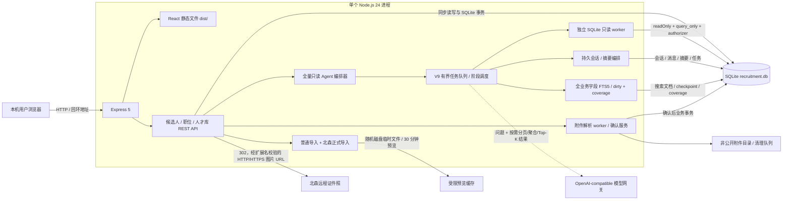
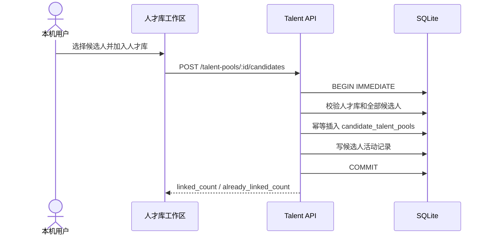
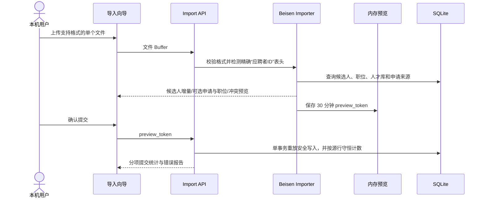

# 人才库工作台架构说明

## 2026-09 人才混合检索补充（应用 0.2.0 / schema V13）

当前代码新增 `search-query-plan`、`search-model-adapters`、`hybrid-search` 与 `hybrid-search-service`。HTTP GET/POST人才检索及应用注入的Agent人才检索工具共用候选人级执行器：模型严格Schema计划→固定SQL资格约束→FTS5/向量召回→RRF融合→最多50人重排→本人/关联证据。查询worker只读，未添加主库迁移；原导航、列表/按职位、筛选和输入框加结果模式保留。

向量在独立目录使用 SQLite 元数据/Float32 和 USearch HNSW 持久化，按模型、维度、切片版本形成不可混用的空间。本次采用 `text-embedding-v4 / 1024 / self-v3-600-80-redacted`：600 字符切片、80 字符重叠，完整材料先遮蔽身份再按原偏移切出出站文本。本地索引保留本人原文及来源定位；独立 Embedding 缓存仅存摘要、向量和内部映射。不可变代际与原子 manifest 保留 active/previous，失败不发布半代，删除/归档在查询时立即失效、维护时清除。

稀疏资格集合在最多 10,000 个事实内精确评分；宽集合转有界 ANN，按 400→800→1600→3200→6400 扩召回，最多累计 12,400 个事实/12,800 个来源行。在本地完整复核硬条件、排除及当前 source hash，重复事实仍可寻找有效替代来源。候选人级融合窗口最多 400，重排最多 50 人；窗口之外的合格候选人仍可稳定深分页。向量近似召回及排序窗口通过 completeness 如实标注。

正式使用单常驻只读 worker 与 mmap；启动预热完整校验，同代只廉价检查，新代先回收旧 worker 释放 Windows 映射。查询规划和查询 Embedding 并行，总请求预算 18 秒（含有界排队），规划 12 秒，Embedding/Rerank 各请求 5 秒；分页复用排序快照。查询理解采用规则约束辅助的 `qwen3.8-flash / none` 模型计划，本地完整 Schema、原文 span 和布尔逻辑校验仍为执行前提。

维护 CLI 增加明确 `--formal` 模式，源库只读 keyset 扫描，网络期间不持源库事务，缓存支持失败后重启。后台维护使用独立进程（异常退出后 PID 锁可恢复），默认并发 4、最大 8、批量 10；维护专用 Embedding 请求上限 30 秒，不改变在线检索的 5 秒请求预算。只改独立索引、不迁移主库。具体授权、实际回填/启用与验收见 [0.2.0 / V13 补充交付](handoffs/2026-09-10-search-hybrid-formal-supplement.md)。

`0.4.0` 起维护改为**增量**且**每个开机周期执行一次**，不再每 5 分钟全量重扫。每轮先按 `candidate_resume_documents` 主键顺序读取身份、`updated_at`、正文字符长度与候选人归档状态（455,744 行约 7.8s，不读履历正文），仅对修订值变化的文档读取正文并比对内容哈希，之后才分块与向量化；修订值写入向量代际内 `documents` 表的 `revision` 列。不可索引文档（归档候选人、高敏感区块、非简历附件）由「取不到正文即移出索引」处理。维护子进程以 BelowNormal 优先级运行；单轮稳态实测 19–20s，chunks 不变时不发布新代际。主库 schema 不变，仍是 `V13`。

混合检索的数据修订检查只读取 `candidate_resume_fts_data` 的结构行。该 FTS5 索引由 `candidate_resume_documents` 触发器同步维护，因此可检测简历文档插入、更新和删除，又不会因 Agent 会话、任务状态或审计等无关写入产生假阳性。向量代际仍通过 manifest identity 单独比较；真实发布新代际时，首轮检索自动回收 worker 并重试一次。

检索执行侧同时改为：`self_docs` 先按倒排索引收窄候选域，再在单次请求内只物化一次到带索引的临时表，供计数、排序、资格集合、向量校验与分页补齐复用；未解析自由文本的本地召回走同样路径。只读打开的向量代际只在首次校验 2.68GB 索引 + 4.10GB 向量库的 SHA-256，之后按 `.verified.json` 记录的文件戳判断。文件型只读连接不再设置 `PRAGMA query_only`（`readOnly` 已阻止主库写入），以允许临时表。下文保留历史架构说明，旧“未启用/未验证”陈述按当时状态理解。

## 2026-09 响应式尺度与导航表面隔离（已完成，2026-09-16）

2026-09-15 的浏览器审计确认：旧 `src/App.tsx` 曾用 `importOpen` 与 `assistantOpen` 两个并列布尔量驱动导入页与拾才助手，导航动作不清除另一个表面，导致同屏叠加、高亮/URL/内容不一致；整站尺度只有单套绝对值，`721–1439px` 无响应式规则，1024–1366px 下表格右侧列被裁。

当前实现把导航表面收敛为单一 `Surface` 联合类型（`page` / `tool` / `import`），由 `src/App.tsx` 持有；`src/views/AppShell.tsx` 只按该状态渲染，任一时刻只有一个表面可见。工具页通过 `tool` 子字段区分 AI 助手、履历检索和附件解析，URL 与状态双向同步，侧栏高亮由 surface 派生；重复点击已激活入口或 Esc 关闭时回到进入前的主页面，`popstate` 反向映射，搜索结果的候选人抽屉不会清空工具表面。

尺度集中在 `src/workspace.css` 末尾第十二轮段落：`:root` CSS token 按 XL ≥1920 / L 1600–1919 / M 1366–1599 / S 1152–1365 / XS 1024–1151 / 平板 721–1023 / 手机 ≤720 降序覆盖；四张主表使用 `table-layout: fixed` 与稳定 `tw-col-*` 类名控制列优先级，并排抽屉按 ≥1600、1440–1599 分级。该层只改表现与导航状态，不新增表、不新增迁移、不改 API 契约、不改检索字段语义。验收口径、实现证据和已知的 ≤720 表格保留偏离见 [设计规范](superpowers/specs/2026-09-15-responsive-scale-and-surface-isolation-design.md)、[实施计划](superpowers/plans/2026-09-15-responsive-scale-and-surface-isolation.md) 与 [第十二轮验收](evidence/talent-redesign/acceptance.md)。

## 1. 文档范围

本文描述当前 `应用 0.5.0`（开发中，尚未正式部署；上一次发布 `0.2.0`）/ schema `V13`、人才库领域历史 `V2` 的真实架构，包括 v3/v4 证件照头像、v5 删除审计、V6 双实体删除/全字段只读 Agent/附件、V6.1 批量交互、V7 大文件导入与人口字段、V8 持久 Agent 会话和全业务字段 FTS5、V9 持久 Agent 任务、V10 持久附件导入批次、V11 入职状态/日期、V12 入职职位与北森关系语义整理、V13 工作年限原文与数值投影、第十二轮响应式尺度与导航 surface 隔离，以及第十四轮头像互斥状态、单层容器、页面型 AI 会话和无效 UI 清理；第十三/十四轮均不增加主库迁移。v1 的候选人、职位和关联能力仍保留，但产品默认视角已经从招聘流程工作台调整为“候选人档案 + 人才检索 + 人才库分组 + 职位关联”。

### 前端头像与 AI 会话结构

- `CandidateAvatar` 和 `TwAvatar` 是头像显示的唯一组件边界。两者由 `has_photo`、候选人 ID 和 `updated_at` 派生受保护头像 URL，并在本地保存失败来源；渲染树在图片和姓名首字之间二选一，不通过绝对定位叠放两个视觉节点。
- `AssistantDrawer` 在当前架构中只渲染 `/assistant` 页面表面，历史会话、正文和输入区位于同一页面状态机内。`tw-content-stack` 在工具页打开时使用条件 `hidden` 保留页面状态并避免双表面；工具页全局导航压缩为图标栏，历史会话在桌面、平板和手机统一使用带 scrim 的覆盖层，不推动会话列。
- Agent 会话、消息、任务和 artifact 事实仍来自既有 API 与 SQLite；本轮只改变 DOM 层级、CSS 布局和展示状态，不修改接口字段、任务状态机或持久化协议。

> 当前仍是个人本机版。服务只允许监听 `127.0.0.1`、`localhost` 或 `::1`，没有登录、认证、RBAC、字段级权限、租户隔离或可靠的多人审计，也没有 SQLite 静态加密。不能把它直接部署成部门多人服务，`CORS_ORIGIN` 也不会改变这一边界。

当前能力包括：

- 候选人 CRUD、人才画像摘要、求职偏好、履历区块、来源记录、历史评估和授权记录。
- 独立人才库及候选人与人才库多对多关联。
- 独立职位及候选人与职位多对多关联。
- 标签、负责人、备注、活动记录、三类核心实体的可恢复归档；候选人/职位受控单条与最多 100 条批量永久删除，以及人才库分组按版本单条/批量永久删除。
- 普通 Excel/CSV 与北森人才档案导入预览和提交，包括显式招聘职位字段的匹配、草稿创建和关系写入。
- 证件照 URL 的受保护存储、最小化投影、受控头像跳转和统一前端回退。
- 18 个服务端白名单工具组成的 SQLite 全字段按需只读 Agent，含受控只读 SQL、聚合、跨实体全业务字段 FTS5、候选人级召回和本地导出。
- SQLite 持久 Agent 会话、游标消息分页、幂等请求、异步长会话摘要和本机历史会话界面；浏览器只保存不透明会话 ID 与界面偏好。
- 文本 PDF、DOCX、XLSX、XLSM、BIFF8 XLS 与 UTF-8 CSV 简历附件的隔离解析、电话/邮箱定位、差异预览、用户确认和私有下载。
- 候选人入职状态、日期和职位的档案维护、北森/通用导入导出，以及按规则筛选的工作簿清理交付。

仍未实现完整 ATS、认证授权、跨业务通用任务队列、集中数据库或受支持的多人部署。V9 只增加了 Agent 专用、SQLite 持久化的有界任务队列；V10 只增加持久附件导入批次；V11/V12 只增加候选人入职事实字段及索引/导入语义。它们都不是 Redis、消息中间件或可横向扩展的通用队列。正式向量索引已在 `0.2.0` 混合检索补充中启用；第十二轮只在其上补充未解析自由文本的本地关键词召回与补齐语义，不改变在线检索预算或向量契约。

## 2. 版本沿革与迁移

`schema_migrations` 记录已应用的数据库版本：

| 版本 | 名称 | 含义 |
| --- | --- | --- |
| 1 | `candidate_workbench_baseline` | 候选人、阶段兼容数据、备注、活动、导入批次、职位和候选人职位关系基线。 |
| 2 | `talent_library_domain` | 人才库、人才画像、求职偏好、来源、历史评估、授权和职位申请来源模型。 |
| 3 | `candidate_photo_avatar` | 给 `candidates` 加法增加 `photo_url`，用于受保护证件照头像。 |
| 4 | `candidate_photo_backfill` | 从既有候选人来源记录回填合法证件照 URL；只填空值，不覆盖已有照片。 |
| 5 | `candidate_deletion_audits` | 迁移登记名；实际创建表 `deletion_audits`，仅保存不含候选人明文的最小删除审计，不修改候选人业务字段。 |
| 6 | `readonly_agent_attachments_fts_deletion` | 加法创建本地附件/预览/字段血缘/清理队列、职位删除审计、Agent 查询审计、履历文档与 FTS5，以及默认停用的本地向量元数据表。 |
| 7 | `candidate_demographics_and_large_import` | 给候选人加法增加性别、生日、年龄和性别索引；大文件导入资源配置本身不增加业务表。 |
| 8 | `agent_sessions_and_full_business_search` | 加法创建 Agent 会话/消息/摘要、全业务字段搜索文档/FTS5、dirty 队列、checkpoint、表级/字段级 coverage 和查询辅助索引。 |
| 9 | `agent_async_tasks_and_phase_audits` | 加法创建持久 Agent 任务表，为查询审计增加 `trace_id`、`task_id` 和阶段，并增加候选人查询辅助索引。 |
| 10 | `durable_attachment_import_batches` | 加法创建持久附件导入批次和项目表及查询索引。 |
| 11 | `candidate_hire_status_and_date` | 加法增加可空 `hire_status`/`hire_date` 及状态/日期索引，不回填旧 `stage`。 |
| 12 | `candidate_hire_information` | 加法增加可空 `hire_position` 及索引；明确入职事实与招聘职位关系分离，并增强北森最后投递职位回填。 |

启动时 `openDatabase()` 先确保 v1 基础表存在，再执行加法迁移。v2-v12 在 `BEGIN IMMEDIATE` 事务中幂等增加模型并执行受控回填，最后登记版本。迁移不会清空或重建旧候选人行，重复启动不会重复建表、重复迁移或覆盖已有照片。V8 首次打开会同步强制回填全业务搜索索引，后续只处理 dirty 项；SQLite 不提供 FTS5、索引回填失败或 coverage 未就绪时明确失败，不静默降级为读取全库正文。V9 不重建 FTS，只增加任务持久化、阶段审计和辅助索引；V10 只增加持久附件导入批次；V11/V12 只增加入职字段和索引，不从旧 `stage` 回填。

当前没有自动 down migration。版本回退必须同时恢复旧代码和升级前数据库文件集，不能只回退代码。

### 2.1 v2 领域表、v3/v4 头像与 v5 删除审计迁移

v2 新增八张表：

1. `talent_pools`
2. `candidate_talent_pools`
3. `candidate_profile_sections`
4. `candidate_preferences`
5. `candidate_source_records`
6. `candidate_assessments`
7. `candidate_consents`
8. `candidate_position_sources`

v2 同时给 `candidates` 增加 `highest_school`、`highest_major`、`job_seeking_status`、`resume_updated_at`、`self_summary`，并给 `positions` 增加北森血缘和职位分类相关列。v3 单独给 `candidates` 增加可空 `photo_url`。v4 扫描既有 `candidate_source_records.raw_payload['证件照']`，只在 `photo_url` 为空且来源值通过照片 URL 校验时回填：协议必须是 HTTP/HTTPS，路径必须以 `.jpg`、`.jpeg`、`.png` 或 `.webp` 结尾，允许签名查询参数；活动只记录回填事实，不记录 URL。旧 `candidates.stage` 保留兼容，不再进入默认 UI 或普通导入映射；V6 Agent 可在用户明确要求时经全字段只读层查询。

v5 新增表 `deletion_audits(id, candidate_id_hash, deleted_at)`（迁移登记名为 `candidate_deletion_audits`）。`candidate_id_hash` 是候选人内部 ID 的 SHA-256，不保存姓名、联系方式、照片地址、来源 ID、原始载荷或任何可恢复候选人的内容。正式库此前已验收 V1-V5，现已在同一加法迁移链上完成 V6。

### 2.2 当前迁移验证状态

- 已在系统临时目录的隔离 `legacy.db` 上反复执行迁移验证，测试构造的旧候选人行和历史 stage 值保留。
- 已确认隔离库可幂等迁移到 v1-v5，八张领域表、`photo_url` 和 `deletion_audits` 存在、`foreign_key_check=0`；v4 不覆盖已有照片，v5 不修改候选人行。
- 早期历史验证：曾将 `backups/pre-positions-20260804-095605/data` 的 SQLite 文件集复制到隔离目录并在副本上执行迁移；版本 1/2、八张 v2 表、记录计数、`integrity_check=ok` 和 `foreign_key_check=0` 均通过。该空数据备份验证不是当前正式库状态。
- 正式照片迁移前已备份到 `backups/pre-photo-avatar-20260804-164342/recruitment.db`；备份含 57 位候选人、schema `[1,2]`，且 `integrity_check=ok`。
- 照片迁移历史结果：候选人当时仍为 57 位，`photo_url` 非空 42 条，照片回填活动 42 条；schema 为 `[1,2,3,4]`，`foreign_key_check=0`、`integrity_check=ok`。
- V5 历史记录：升级前完整正式 SQLite 文件集备份到 `backups/pre-v5-formal-20260805-102510/`，`.db`、`-wal`、`-shm` 三件文件 SHA-256 逐项一致；当时迁移后 schema 为 `[1,2,3,4,5]`，候选人 57、归档 0、职位 0、人才库 14、照片 42，`integrity_check=ok`、`foreign_key_check=0`。
- 正式数据库未用于自动化或截图测试。
- V6 前正式服务已停止，并把同一时点的 `recruitment.db`、`recruitment.db-wal`、`recruitment.db-shm` 备份到 `backups/pre-v6-agent-attachments-delete-20260805-120858/`；源文件与备份逐文件 SHA-256 一致。匿名隔离数据库门禁通过后，正式迁移显式绑定 `data\recruitment.db` 并成功完成；schema `[1,2,3,4,5,6]`，9 个 V6 预期表/虚表无缺失，履历同步 trigger 11 个，`candidate_resume_documents` 112 条并覆盖 70 位候选人，`candidate_attachments=0`、`candidate_resume_vectors=0`，`integrity_check=ok`、`foreign_key_check=0`。正式库未执行永久删除。
- V5 历史 Playwright 已使用匿名隔离数据库完成 1440x900 与 390x844 的统一候选人头像、首字母失败回退及核心人才库操作验收，两种视口控制台 0 错误、0 警告。
- V6 Playwright 已真实走通附件、FTS5 履历证据和候选人/职位删除预览 API；最终复验修复批量操作栏负 margin 导致的移动端遮挡，1440x900 与 390x844 根节点宽度等于 viewport，控制台 0 error、0 warning。最终截图为 `output/playwright/final-v6-security-20260805/desktop-1440x900-fixed.png` 与 `output/playwright/final-v6-security-20260805/mobile-390x844-fixed.png`；正式库未提交候选人或职位永久删除。
- V8 已在匿名内存/临时文件型 SQLite 完成全业务字段搜索、持久会话、只读目录隔离、无正文分段审计和历史回归自动化；完整 `npm test` 为 141/141，V8 搜索聚焦 9/9，与旧履历检索联合 14/14，TypeScript、生产构建、低级别依赖审计和服务端语法检查通过。匿名 10,000 人基准完成 191/191 字段覆盖和 446,259 份 FTS 文档回填，双视口浏览器验收也已通过。
- 2026-08-06 正式旧 PID `17212` 经 SIGINT 正常退出并释放 `4173`；同一时点 SQLite 三件套备份、恢复副本 V7→V8 门禁和正式 V8 加法迁移随后完成。正式迁移保持候选人/职位/人才库及两类关系聚合计数不变，达到 19/19 张政策表、191/191 个字段 ready、120,806 个业务源记录、2,629,351 份 FTS 文档、dirty 0，完整性正常且外键异常 0 条。新 PID `7232` 仅监听 `127.0.0.1:4173`，health、会话和 schema 工具返回 200，18 个只读工具与持久会话已加载；该核对不包含候选人明文或搜索内容验证。
- 2026-08-07 在 100,000/120,000 位匿名容量、并发/取消/partial/恢复、分层超时和双视口门禁通过后，正式 V8→V9 维护完成。旧 PID `7232` 退出并释放 `4173`，SQLite 三件套逐文件备份/哈希一致，恢复副本与正式库均从 schema `[1..8]` 加法升级到 `[1..9]`；候选人 8,209、职位 312、人才库 35、两类关系 9,980/6,224、来源记录 32,834、履历 FTS 8,430、全业务 FTS 2,629,388、checkpoint/coverage/搜索摘要均保持，dirty 0、`integrity_check=ok`、外键异常 0。当前 PID `22904` 只监听 `127.0.0.1:4173`，health、根页面和 Agent status 返回 200，`async_tasks=true`、18 个只读工具加载；正式验收未执行候选人搜索、模型问答、截图、负载或写入，详见 [v9-formal-deployment.json](evidence/v9-formal-deployment.json)。

## 3. 运行时拓扑



生产式本机启动时 Express 同时提供 `dist/` 和 `/api`。开发时 Vite 代理 API。没有缓存服务、对象存储或独立数据库进程。简历附件进入数据库同目录下的非公开私有目录；解析和 Agent SQL 均在独立 worker 中受超时限制。证件照头像仍是与简历附件不同的远程 URL，浏览器按需跳转加载。

Express 中间件顺序把 Origin 写保护放在 `express.json()` 和后续 multipart 路由之前。非 `GET` / `HEAD` 请求若携带不允许的 Origin，会在读取 JSON 或附件内容前返回 `403 origin_not_allowed`；缺少 Origin、回环 Origin 和显式配置的 Origin 保持兼容。不允许的预检请求同样返回 `403`。这一顺序缩小了跨站页面驱动敏感写入和恶意大请求体进入解析器的机会，但不替代认证、RBAC 或多人版 CSRF 设计。正常接受的应用响应还设置 `nosniff`、`X-Frame-Options: DENY`、`Referrer-Policy: no-referrer`、受限 `Permissions-Policy`，并用 CSP 的 `frame-ancestors 'none'`、`default-src 'self'`、`base-uri 'none'` 和 `object-src 'none'` 收紧浏览器执行面。

## 4. 模块职责

| 路径 | 职责 |
| --- | --- |
| `server/index.mjs` | 配置加载、回环监听校验、HTTP 与 SQLite 生命周期。 |
| `server/app.js` | REST 路由、中间件、统一错误、删除预览/提交、附件、履历检索、Agent 工具与候选人头像跳转。 |
| `server/database.js` | v1 基础 schema、`schema_migrations`、v2-v12 加法迁移、照片/人口字段回填、附件/删除/审计/会话/搜索索引模型及候选人聚合详情。 |
| `server/candidates.js` | 候选人 CRUD、筛选、去重、单条/批量归档、恢复、备注、活动、导出查询和 dashboard。 |
| `server/positions.js` | 职位 CRUD、筛选、候选人关联与解除，以及版本绑定的事务式批量归档。 |
| `server/deletions.js` | 候选人和职位的 1-100 条删除预览令牌、版本快照、提交事务、最小审计和附件清理入队。 |
| `server/attachment-parser*.js` | 文件扩展名/MIME/签名/容器限制和 PDF、DOCX、Excel/CSV 独立 worker 解析。 |
| `server/attachments.js` | 隔离区/正式附件存储、身份匹配、字段与履历建议、确认事务、SHA-256 幂等、下载和清理重试。 |
| `server/readonly-query*.js` | 文件型数据库独立只读子进程、schema 目录、单语句边界、SQLite authorizer、分工具超时/取消、RSS 采样、结构化查询与 CSV 导出。 |
| `server/business-search.js` | V8 业务表/字段政策、JSON 展开、4,000 字符分段、中文 token、搜索文档/FTS5、dirty 同步、coverage 核验、全记录与候选人级检索。 |
| `server/resume-search.js` | 自然语言关键词/同义词和结构化条件标准化，将既有履历检索 API 路由到 V8 全业务搜索并保持候选人级响应兼容。 |
| `server/talent.js` | 人才库 CRUD、成员关联、版本绑定的批量归档/恢复/容器永久删除、求职偏好和履历区块写入。 |
| `server/import-export.js` | ExcelJS/`xls-reader` 服务端解析、格式签名校验、预览提交、导出及北森导入分派。 |
| `server/beisen-import.js` | 北森单表识别、候选人/申请/职位预览、重放安全写入、逐行计数和数据血缘。 |
| `server/agent.js` | 18 个全字段按需只读工具、基于证据进展的持续编排、Top-K 上下文限制、V9 有界并发调度/取消/自动续跑/partial、会话问答/异步摘要编排和无正文分段审计。 |
| `server/agent-sessions.js` | 会话 CRUD、消息游标分页、请求锁/幂等、任务/阶段/心跳/结果持久化、失败恢复、上下文预算和摘要计划。 |
| `src/App.tsx` | 页面路由、工作区数据、筛选、跨实体操作编排，以及桌面侧栏收起状态的安全持久化。 |
| `src/api.ts` | 候选人、职位、人才库、删除、附件、履历检索、导入和 Agent REST 客户端。 |
| `src/components/TalentPoolPage.tsx` | 人才库列表、成员工作区、批量加入/移出，以及分组选择、归档、恢复和容器永久删除。 |
| `src/components/Candidate*` | 候选人列表、职位分组、五页签详情、分区编辑表单和统一 `CandidateAvatar`。 |
| `src/components/Position*` | 职位列表、表单和职位详情工作台。 |
| `src/components/ImportWizard.tsx` | 普通映射预览与北森候选人/申请/职位分项预览。 |
| `src/components/AssistantDrawer.tsx` | 持久 Agent 会话入口、历史会话列表/重命名/删除、加载更早消息和附件工作流；仅 Agent 回复交给安全 Markdown 组件。 |
| `src/components/AssistantMarkdown.tsx` | 使用 Markdown/GFM 结构化渲染 Agent 回复，不启用 raw HTML；链接与图片 URL 经过服务端无关的前端安全策略。 |
| `src/components/AttachmentWorkflow.tsx` | 拖放上传、解析/匹配状态、逐字段差异选择和候选人详情附件列表。 |
| `src/components/PermanentDeleteDialog.tsx` | 候选人/职位共用的一次确认弹窗，展示各自影响范围和服务端预览令牌状态。 |

## 5. 核心数据模型

```mermaid
erDiagram
    CANDIDATES ||--o{ NOTES : has
    CANDIDATES ||--o{ ACTIVITIES : has
    CANDIDATES ||--o{ CANDIDATE_POSITIONS : linked
    POSITIONS ||--o{ CANDIDATE_POSITIONS : linked
    CANDIDATES ||--o{ CANDIDATE_TALENT_POOLS : grouped
    TALENT_POOLS ||--o{ CANDIDATE_TALENT_POOLS : contains
    CANDIDATES ||--o{ CANDIDATE_PROFILE_SECTIONS : has
    CANDIDATES ||--o| CANDIDATE_PREFERENCES : has
    CANDIDATES ||--o{ CANDIDATE_SOURCE_RECORDS : sourced
    CANDIDATES ||--o{ CANDIDATE_ASSESSMENTS : assessed
    CANDIDATES ||--o{ CANDIDATE_CONSENTS : consented
    CANDIDATES ||--o{ CANDIDATE_POSITION_SOURCES : applied
    POSITIONS ||--o{ CANDIDATE_POSITION_SOURCES : sourced

    CANDIDATES {
        text id PK
        text name
        text current_title
        text highest_school
        text highest_major
        text job_seeking_status
        text hire_status "source fact; nullable"
        text hire_date "YYYY-MM-DD; nullable"
        text hire_position "source fact; nullable"
        text stage "legacy compatibility"
        text archived_at
    }
    TALENT_POOLS {
        text id PK
        text name UK
        text color
        text source_system
        text source_record_id
        text archived_at
    }
    CANDIDATE_TALENT_POOLS {
        text candidate_id PK,FK
        text talent_pool_id PK,FK
        text created_at
    }
    CANDIDATE_PROFILE_SECTIONS {
        text id PK
        text candidate_id FK
        text section_type
        text content
        text structured_data "JSON"
        text sensitivity
    }
    CANDIDATE_PREFERENCES {
        text candidate_id PK,FK
        text desired_titles "JSON"
        text desired_locations "JSON"
        text expected_salary
        text raw_payload "JSON"
    }
    CANDIDATE_SOURCE_RECORDS {
        text id PK
        text candidate_id FK
        text source_system
        text source_record_id
        text record_type
        text raw_payload "JSON"
    }
    CANDIDATE_ASSESSMENTS {
        text id PK
        text candidate_id FK
        text position_id FK
        text assessment_type
        text conclusion
        text raw_payload "JSON"
    }
    CANDIDATE_CONSENTS {
        text id PK
        text candidate_id FK
        text consent_type
        text status
        text raw_payload "JSON"
    }
    CANDIDATE_POSITION_SOURCES {
        text id PK
        text candidate_id FK
        text position_id FK
        text source_application_id UK
        text raw_payload "JSON"
}
```



候选人入职字段是独立的事实层：`hire_status` 保存来源状态原文，`hire_date` 保存规范化日期，`hire_position` 保存来源入职职位文本。有效日期存在而状态为空时写入精确值 `不确定`；三项全空只影响详情页是否渲染“入职信息”区块，不删除候选人，也不改变人才库或搜索可见性。`hire_position` 永远不作为招聘职位关系键。

北森的招聘关联使用“最后职位类投递的职位id”。该值为空时不创建 `candidate_positions`；值为职位名称而不是 `Jxxxxx` 编码时，导入按 `应聘者ID + 最后职位类投递时间` 查找历史申请职位，唯一命中则复用正式职位编码，未命中才用稳定来源键创建草稿职位。`入职雇佣关系` 留在来源快照，人才库关系写入 `candidate_talent_pools`，来源历史写入 `candidate_source_records`，三者互不替代。

`candidate_positions` 和 `candidate_talent_pools` 都用复合主键阻止重复关系。正常解除关系只删除关系行，不删除候选人、职位或人才库。候选人、职位和人才库分组均只有在归档后才能永久删除：候选人删除依赖级联清除候选人从属记录并把物理附件加入清理队列；职位删除只级联职位关系/从属记录并保留候选人；人才库删除只显式删除 `candidate_talent_pools` 关系及分组主记录，候选人所有权数据完全不在删除集合内。

### 候选人归档与删除流

1. 单条归档或批量归档先校验候选人存在且未归档；批量上限 100，使用一个 SQLite 事务并为每位候选人写活动。
2. 已归档候选人拒绝编辑、备注、偏好/履历替换以及职位或人才库关系变更，只允许读取、恢复或进入永久删除确认。
3. 永久删除先预览：服务端校验 1-100 个目标均已归档，并将操作类型、排序后的 ID 与 `updated_at` 快照绑定到默认 2 分钟的一次性令牌。界面只显示一次确认弹窗，不要求输入确认词。
4. 提交令牌时，在 `BEGIN IMMEDIATE` 事务内重新校验全部目标的存在性、归档状态和版本；任一异常返回 `409`，整批不部分删除。令牌过期、跨操作使用或重放也拒绝。
5. 单条 URL 提交同时把路径 ID 作为期望目标校验；只有 token 快照恰好包含同一唯一 ID 才继续，防止把批量 token 提交到单条端点。
6. 候选人删除前将附件路径写入可重试清理队列，再级联删除候选人从属记录、履历/FTS/向量数据并写最小审计；事务提交后立即尝试物理删除，失败任务由定时维护重试。
7. 职位删除收集受影响候选人，在同一事务写“关联职位已永久删除”活动、删除职位及关系并写职位最小审计；候选人及其附件、备注、人才库关系保持完整。
8. 删除后的候选人或职位因主记录已不存在，自然从列表、搜索、统计、导出、详情、FTS5 和 Agent 查询中消失。

该流程只覆盖当前 SQLite，不调用北森等来源系统，也不遍历或销毁历史备份。无认证个人版仍不能提供可靠操作者身份审计。

### 职位与人才库批量状态变更

- 活动职位批量归档接收 1-100 个 `{ id, expected_updated_at }`。服务端在一个事务中先读取并校验全部目标，再逐条以状态和版本作为 `UPDATE` 条件；缺失、已归档、版本冲突或运行时写入失败都使整批回滚。该操作不删除职位关系或候选人。
- 人才库分组批量归档、恢复和永久删除使用同一版本绑定记录结构。归档只接受活动分组，恢复/删除只接受已归档分组；重复 ID、超过 100 个、缺失、状态不符或版本变化均在写入前拒绝。
- 人才库永久删除事务先统计候选人关系，再删除目标分组的 `candidate_talent_pools` 行和 `talent_pools` 主行。事务返回受影响唯一候选人数与关系数，不触碰 `candidates` 及其备注、活动、附件、履历、职位关系或其他从属表。

## 6. 人才库模块与数据流

### 6.1 查询与展示

候选人列表响应包含非敏感摘要、`positions: []` 和 `talent_pools: []`。查询支持：

- `pool_id=<人才库 ID>` 或 `pool_id=unassigned`
- `position_id=<职位 ID>` 或 `position_id=unassigned`
- `education`、`school`、`major`、`job_seeking_status`
- 来源、负责人、标签、归档、搜索、分页和稳定排序

关系筛选使用 `EXISTS` / `NOT EXISTS`，不会因多对多连接复制候选人主记录。前端人才库页通过独立人才库 API 读取分组和成员，批量加入/移出均调用事务化业务接口。

### 6.2 人才库关联



移出使用同一路径的 `DELETE` 批量接口，返回 `unlinked_count` 和 `not_linked_count`。人才库归档不会归档其成员，候选人归档也不会删除人才库关系。

### 6.3 候选人详情

默认 `GET /api/candidates/:id` 返回人才档案摘要、职位、人才库、履历区块和经过裁剪的来源/评估/授权元数据。它不返回完整联系方式、薪资、源记录 ID、legacy stage 或 `raw_payload`。

普通候选人列表和普通详情也不返回 `photo_url`，只返回 `has_photo`。`CandidateAvatar` 在有照片时请求 `GET /api/candidates/:id/avatar`；服务端重新校验协议为 HTTP/HTTPS、路径以 `.jpg`、`.jpeg`、`.png` 或 `.webp` 结尾，并允许签名查询参数，再以 `302` 跳转。响应使用 `Cache-Control: private` 和 `Referrer-Policy: no-referrer`。图片加载失败时组件保留固定尺寸并回退姓名首字母。只有 `include_sensitive=true` 才返回原始 `photo_url`。

只有本机用户在详情中明确选择查看敏感资料或进入编辑时，前端才调用：

```text
GET /api/candidates/:id?include_sensitive=true
```

敏感结果只进入当前详情会话，不合并回全局候选人列表或搜索状态。Agent 不复用该 HTTP 投影；它通过独立只读连接按用户问题读取所需全字段。

## 7. 北森增量导入数据流

北森专用轮廓以大小写准确的 `应聘者ID` 作为唯一必需稳定字段。相同 ID 的多行先在文件内合并，同一文件中后出现的非空标量覆盖先出现值，也可以跨文件、跨批次用非空值补充资料；非空姓名和“证件照” URL 均可更新，空值不清除旧值，标签取并集且最多 50 个，姓名仍不参与自动合并。已有 ID 可以省略姓名，新 ID 必须提供姓名；电话或邮箱与其他候选人冲突时整条候选人更新被阻断。预览只返回 `has_photo`，不会返回签名 URL。

`申请ID` 和职位信息是可选关系信息。北森专用轮廓把 `最后职位类投递的职位id` 作为招聘职位关系键（优先于入职事实字段）；它为空时只跳过职位关系，不创建占位职位。若该值是职位名称，服务端结合候选人 ID 与 `最后职位类投递时间` 回查历史申请职位，唯一命中则复用该职位；无历史命中时才使用稳定来源键创建草稿。显式职位信息无效、匹配存在歧义或命中归档职位时，受影响源行标记失败，不写入该行候选人、职位、关系或原始载荷，必须人工复核。申请 ID 只有在职位关系可建立或该行存在真实评估载荷时才参与文件内重复、既有归属和提交竞态校验；否则未使用的申请信息只记为跳过。参与校验的申请 ID 一旦属于另一候选人便阻断，绝不改绑。`入职职位` 只进入候选人主档，`入职雇佣关系` 只进入来源原始载荷。Offer/录用只进入候选人来源原始载荷，`自我评价` 进入 `candidates.self_summary`；二者均从评估分类器排除。

预览先排除失败行，再合并候选人和职位。提交按源行守恒计数，成功触达同一候选人的多行分别计入导入或更新行，`candidate_count` 只计算唯一候选人；失败行不贡献候选人、职位、关系或原始载荷。

服务端支持 `.xlsx`、`.xlsm`、UTF-8 `.csv` 和未加密 BIFF8 `.xls`。`.xls` 先校验 OLE2 魔数，再由受控的服务端解析器读取第一张工作表；伪装扩展名、加密或非 BIFF8 文件被拒绝。已审计三份真实 `.xls` 中只有第三份包含精确 `应聘者ID`，因此前两份不能按姓名、行号或当前排序与第三份自动合并，需重新导出带该字段的版本。



未包含精确 `应聘者ID` 的支持格式仍走通用字段映射流程。北森 profile 由该表头单独触发，`申请ID` 和职位信息不参与轮廓识别。

北森重放不会重复创建候选人、职位和关系，但不是严格状态幂等：已有候选人仍会更新 `updated_at`、`import_batch_id` 并追加 `candidate_import_updated` 活动，最近更新排序也会变化。

## 8. Agent 数据流与边界

Agent 是 SQLite 全字段按需只读层，不是业务写连接。每次工具调用由父进程启动受限 worker，worker 以 `readOnly` 打开数据库，设置 `query_only=ON`、`trusted_schema=OFF`、defensive mode 和 64 MB heap limit，并禁用扩展加载、双引号字符串和 mmap。服务端语句扫描只负责单条 `SELECT`/`WITH` 边界；真正的表、列、函数和操作码授权由 SQLite authorizer 按实时 schema 目录完成，因此不依赖正则表达式判断 SQL 安全。

工具分为 schema、自由只读 SQL、目录驱动结构化查询、候选人/职位完整图、备注/活动/来源/评估、人才库、聚合、跨实体全业务字段搜索、候选人级履历召回、附件文本和受控 CSV 导出，共 18 个。`search_all_records` 在候选人、职位、人才库、来源、附件和最小删除审计等实体上去重返回证据；`search_candidate_resumes` 将关联业务命中聚合为候选人级 Top-K。常规结果最多 100 行、1 MB、默认 3 秒，SQL 最长 50,000 字符；导出最多 50,000 行/25 MB。

SQL/FTS 查询会记录实际表/列/函数范围、耗时、行数和错误；`business_search_sync`、模型网关等待、`agent_tool_call:<name>` 工具执行及 `agent_response_assembly` 响应组装另写阶段审计。所有这些记录均不保存用户问题、Agent 回复、工具参数/结果或敏感正文；非查询阶段范围为空、行数为 0。

检索链路为“自然语言条件 -> 结构化字段 + 同义词/关键词 -> SQLite 全量业务字段筛选 + FTS5 -> 候选人级去重排序 -> Top-K 完整资料与片段 -> 模型回答”。常规候选人检索默认 20、最多 50 位进入单次模型上下文，每位返回 1 至 5 条证据；默认多概念路径只为已召回 Top-20 构建候选人范围关系子集，再按概念优先选取真实命中证据，不对全库展开关系证据，也不扩大模型上下文。查看更多使用分页，统计由 SQLite 聚合，完整明细落本地导出。模型总上下文最多 512 KiB；V9 不设固定总工具调用数，按需持续取数，同一批最多并发 4 个，并用语义参数指纹和真实结果证据去重。没有成功工具证据的数据问答不能进入 `completed`。现有网关未确认 Embedding，未连接其他服务，向量表仅作未来本地元数据预留。

用户已明确授权 Agent 在问题需要时读取未打码手机号/邮箱、薪资、照片地址、备注、活动、完整履历、评估、授权、原始载荷、附件文本、归档记录和最小删除审计。数据库内容均用“不可信数据”封套交给模型，不能触发额外工具或改变权限。Agent 没有新增、更新、归档、恢复、关联、附件确认、删除、终端、任意文件或 HTTP 工具。配置远程网关后，用户问题、最近对话及必要敏感结果可能离开本机，必须先完成数据处理评审。

Agent 消息到达前端后，只有 `assistant` 角色内容进入 Markdown/GFM 渲染器；`user` 角色始终作为普通文本节点。渲染层不启用 raw HTML 或 `dangerouslySetInnerHTML`，URL 策略拒绝脚本/数据等危险协议和远程 Markdown 图片，外部链接使用新窗口及 `noopener noreferrer`。代码块和表格在消息容器内滚动，因此模型输出不能借 HTML 执行脚本，也不能把抽屉或页面根节点横向撑开。该展示安全层不改变后端 Agent 的工具权限。

### 8.1 V8 持久会话与全业务搜索

会话正文不再由浏览器临时状态或调用方传入的 `history` 充当事实来源。V8 的数据流是：

```text
新建/恢复活动会话
-> POST 消息 + client_request_id
-> SQLite 写 processing 用户消息并占用会话请求锁
-> 从最新摘要 + 最近完成消息构造不超过 96 KiB 的历史
-> 受控只读工具 / 模型问答
-> 同事务完成用户消息并写 Agent 回复
-> 异步评估并生成长会话摘要
```

`agent_sessions` 保存标题、活动/归档状态、序号和当前请求锁；`agent_messages` 保存用户/Agent 正文、状态、模型、工具名及字节统计；`agent_session_summaries` 保存到某个消息序号为止的压缩摘要。`client_request_id` 在同一会话和相同正文下可幂等重放：完成态返回原回复，处理中返回 `202`，ID 被不同请求复用、会话忙或已失败时返回 `409`。请求锁超过 2 分钟视为陈旧，原 processing 消息标记为失败，后续必须使用新 ID。

最近上下文最多 12 条/96 KiB；达到 12 条消息或 96 KiB 后，摘要任务最多读取 256 KiB，保留最近 6 条不压缩，摘要正文最多 16,000 字符。摘要调用复用已配置模型网关、使用 strict JSON Schema 且不提供 tools；历史与摘要均包装为不可信数据。摘要失败只停止本次压缩，不回滚已经完成的问答。

浏览器 `localStorage` 只保存符合 UUID 格式的活动会话 ID 和历史面板开关；消息正文、摘要、手机号、邮箱、薪资和简历都只从 SQLite 会话 API 读取。消息按 `before_sequence` 游标加载，删除会话由外键级联删除消息与摘要。API 支持归档/恢复会话，归档状态拒绝继续发送；当前抽屉历史面板只列活动会话，提供新建、重命名和永久删除。

V8 搜索字段由显式 `TABLE_POLICIES` 和每张表实时 `PRAGMA table_xinfo` 的交集确定：所有非隐藏、非 BLOB 且未显式排除的字段进入 `search_documents_v2`；JSON 字段递归展开为稳定 `field_path`，长文本按 4,000 Unicode code point 分段且可无损拼回，中文搜索文本补充二元/三元 token。`candidate_attachments.storage_path`、`candidate_resume_vectors.vector`、会话/消息/摘要、附件预览/清理、迁移账本及搜索内部表不进入普通 Agent 目录或业务 FTS；`agent_query_audits` 可只读查询但不参与 FTS，避免审计写入反复污染索引。

政策业务表的 INSERT/UPDATE/DELETE 触发器只向 `search_index_dirty_v2` 写幂等行并把全局 checkpoint 降为 `pending`。`synchronizeBusinessSearch()` 在同一业务写事务内删除旧搜索文档、重建目标记录、清理 dirty 项；队列清空后按表和字段重算 coverage 并恢复 `ready`。首次 V8 打开强制全量回填，之后启动只同步 dirty 项。检索在 checkpoint 或 coverage 未就绪时返回错误，绝不静默绕过索引读取整库正文。

### 8.2 V9 异步任务、失败隔离与大规模查询

V9 把“一次 HTTP 请求等待完整回答”拆成可恢复的任务生命周期：

```text
POST 消息 + client_request_id
-> SQLite 写入 agent_tasks(queued) 并快速返回任务信封
-> 有界进程内调度器按并发预算取任务
-> planning -> querying -> retrieving -> composing
-> completed / partial / failed / cancelled
-> 前端按 task_id 轮询，刷新后从 SQLite 恢复
```

`agent_tasks` 保存任务/追踪 ID、会话和用户消息引用、请求哈希、阶段、受限工具结果、计数、`has_more`、分阶段耗时、错误、心跳和完成时间。它不保存隐藏系统提示、完整模型请求或无限量工具原始结果。`client_request_id` 仍与会话和正文哈希绑定；重放返回原任务，不重复创建任务。服务进程中断或受控关闭时，遗留活动任务保持非终态并在下次启动重新排队；已有快照会继续保留，重新执行原问题时仍允许补取不足证据。用户主动取消才进入 `cancelled`。

调度器默认最多同时运行 2 个任务、排队 20 个；短同步窗口默认 650 ms，超过窗口的请求返回 `202`。SQL、FTS、模型规划和模型回答分别使用默认 3 s、8 s、25 s、45 s 的单阶段超时，并对可恢复故障做有限退避重试；正常任务没有固定整体 deadline。用户取消会通过 `AbortSignal` 终止模型请求，并杀死正在执行的独立只读查询子进程；服务关闭使用独立中断原因，把任务留给下次启动续跑。超时导出会清理未完成文件。队列满返回 `task_overloaded`，而不是继续无界占用进程。

模型编排持续执行到取得足够真实证据并生成回答，不使用固定总轮次或总工具调用数截断正常问题。递归稳定序列化会识别仅对象键顺序不同的等价调用；结果证据指纹区分新证据、重复结果和连续无进展，达到无进展阈值后只允许基于已有成功证据收束，没有任何成功证据则明确失败。模型上下文仍限制为 512 KiB。宽泛 FTS 查询默认走不计算精确总数的 fast Top-K：先按 BM25 有界过采样文档命中，再映射/聚合候选人或实体并返回当前页与 `has_more`。只有用户明确要求精确数量时才执行完整计数。结构化统计仍由 SQLite 聚合，完整明细仍走受控导出；不会把 100,000 个候选人或全部命中装入 Node.js 数组或模型上下文。

数据库工具一旦返回结果，服务端立即把受字节上限约束的快照写入任务。后续执行失败时任务进入 `partial`，前端仍可展示已保留结果、失败阶段和错误类型，并可从证据快照继续生成；恢复后的编排会先复用真实证据，证据不足时继续执行新的只读数据库工具。`agent_query_audits` 通过 `trace_id`、`task_id` 和 `phase` 关联排队后的 SQL/FTS、模型等待、工具调用和组装耗时，但不记录问题、查询参数、消息正文或敏感结果。

100,000 位候选人和 120,000 位容量余量是 V9 的匿名验收门槛，不是人数硬上限。2026-08-06 已完成两档匿名文件型 SQLite 验收：100,000 位生成 12,307,691 份业务 FTS 文档、回填 5,081,607.932 ms，数据库 16,394,866,688 bytes，主进程峰值 RSS 417.539 MiB；120,000 位生成 14,768,819 份业务 FTS 文档、回填 5,614,112.093 ms，数据库 19,687,194,624 bytes，主进程峰值 RSS 435.84 MiB。两档均为 `checkpoint=ready`、`dirty=0`、字段 coverage `191/191`；120,000 位 postcheck 的宽泛 OR/AND、混合候选人和结构化问答均通过。并发探针在 100,000 位副本上验证 2 running + 2 queued、取消、partial/仅重试回答、重启恢复和 API overlap。详细冷/热耗时、Worker RSS、响应字节和已知限制以 `docs/TESTING.md` 的 V9 实测记录为准；这些结果不等价于真实生产数据分布或多人部署吞吐。

### 8.3 附件解析与确认数据流

1. 上传进入随机命名的非公开 `quarantine/`，同时校验 15 MB、清洗文件名、扩展名、MIME 和文件签名/容器。服务端持久化 `parsing` 后立即返回 `202`、`preview_id`、`Location`、`Retry-After` 和轮询间隔，浏览器请求不等待解析完成。
2. 有界解析调度器启动独立 worker 解析文本型 PDF、DOCX、XLSX/XLSM、BIFF8 XLS 或 UTF-8 CSV；单次 worker 安全上限为 60 秒，取消、过期和服务关闭会中断运行中或跳过排队中的任务。worker 禁止脚本、宏、外部文件访问、远程资源和子进程，并限制 PDF 页数、Office 条目/解压体积、工作表/行/列及文本长度。Office ZIP 由 worker 复核 central/local entry，stored/deflate 数据会被实际读取或 `inflateRawSync` 解压；实际长度必须等于声明长度，并按实际单条、累计 64 MB 和压缩比执行限制，ZIP64、加密和未知压缩方法明确失败。Worker 的 V8 `resourceLimits` 为 old generation 256 MB、young generation 64 MB、code range 32 MB、stack 4 MB，且 `execArgv: []`；这些是 V8 Worker 上限，不是 Node 进程总 RSS 硬上限。
3. 服务端只按标准化手机号/邮箱精确定位；姓名、公司、学校、职位和文件名不参与自动合并。解析、身份结果、字段建议、证据和当前值写入短期预览，候选人不变。两种身份均无匹配时，前端可按解析姓名调用现有候选人搜索，或复用现有新建候选人校验与审计流程；手动选中已有档案后必须针对其真实当前值重新计算差异和默认选项。
4. 若现有 Agent 模型网关已配置，生产 suggestion provider 最多发送 120,000 字符和 100 条记录，用 strict JSON Schema、无 tools 的 Chat Completions 补充建议；附件 JSON 被明确标记为不可信。建议阶段最多额外等待 5 秒，网关不可用、超时或返回无效结构时保留本地规则建议，不阻塞本地解析终态。
5. 用户逐字段/区块选择并确认；业务 API 校验一次性 token、候选人 `updated_at`、归档状态、身份冲突、字段格式和合并模式后，在单事务保存附件、字段血缘、履历区块、活动和 FTS5 文档。
6. 同一候选人同 SHA-256 简历幂等。取消、失败、过期、确认后的隔离文件以及候选人删除后的正式附件均先安全删除；失败进入 `attachment_cleanup_jobs` 定时重试。预览一旦 `confirmed`、`cancelled` 或 `expired`，数据库同时清空临时正文和建议 JSON，只保留最小状态。后台完成写入带 `WHERE parse_status='parsing'`，不会覆盖这些终态。

## 9. 安全措施与明确缺口

已经实现：

- 强制回环监听；Origin 写保护在 JSON/multipart 请求体解析前拒绝不允许的跨域写请求，正常应用响应设置 CSP、禁止 framing、`nosniff`、no-referrer 和受限 Permissions Policy。
- 服务端字段、查询参数、长度、枚举和批量数量校验。
- SQLite 外键、唯一约束、事务、WAL 和忙等待。
- 候选人、职位和人才库软归档。
- 敏感候选人详情仍显式加载；Agent 则按用户明确决定提供全字段按需只读，并用分页、Top-K 与审计限制传播。
- 照片原始 URL 从普通响应、导入/附件预览和默认导出排除；头像跳转设置 private cache 和 no-referrer，前端失败回退首字母。Agent 按用户明确问题可经独立 SQLite 全字段只读层读取该 URL，但不会把它放入默认 UI 状态或无关模型上下文。
- Agent 18 工具白名单、独立只读连接、SQLite authorizer、查询/字节/超时/导出上限，无写工具。
- Agent 回复的角色隔离 Markdown/GFM 渲染、raw HTML 禁用、危险 URL 拒绝和外链 `noopener noreferrer`；数据库提示注入文本只作为内容显示。
- 附件扩展名/MIME/签名/容器联合校验、Office 实际解压尺寸/压缩比校验、隔离存储、有界解析并发、60 秒 worker 安全上限与取消信号、V8 Worker 资源限制、SHA-256 幂等和可重试物理清理。
- CSV 公式触发字符中和。

尚未实现：

- 登录、认证、SSO、RBAC、字段级权限和租户隔离。
- HTTPS、受支持的局域网或公网监听。
- SQLite 或字段级静态加密；数据库文件和备份中的敏感值当前是明文数据。
- 不可伪造安全审计、管理员复核、备份调度、监控和灾备。
- 自动 down migration 和无人值守升级回退。
- 适用于多用户并发和共享存储的架构。
- 面向多人的附件鉴权、病毒扫描、集中密钥/存储和不可伪造审计；当前本地简历附件目录只适用于单用户回环版，远程证件照仍依赖来源服务和网络。

因此当前多人部署仍不支持。部门版必须先完成认证/RBAC/字段级权限，并把远程证件照迁入受控本地或内部附件存储；之后还需完成传输与静态加密、集中审计、共享数据库、备份恢复和并发验证，不能只修改 `HOST` 或增加反向代理。
