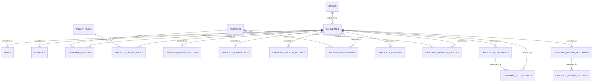

# 数据模型

## 适用范围

本文描述当前 SQLite 人才库的实际模型。默认数据库为 `data/recruitment.db`，测试使用 `:memory:` 或临时数据库。

系统的业务中心是“候选人资料 + 人才库分组 + 职位关联”。它保留从北森导入的申请、面试、测评、授权和其他原始历史，但这些记录是可追溯资料，不是可执行的招聘流程。当前仍不是完整 ATS：没有面试排期、面试官任务、Offer 审批、入职流程、用户、RBAC 或租户实体。

`candidates.current_title` 表示候选人当前任职；`positions.title` 表示平台中的招聘职位。`candidates.stage` 是旧版全局招聘阶段，仅作数据兼容：它默认不进入普通候选人响应和自动导入映射，但可由用户通过 V8 Agent 业务全字段只读工具显式查询。

## 迁移版本

`schema_migrations` 记录已应用的版本：

| 版本 | 名称 | 作用 |
| ---: | --- | --- |
| 1 | `candidate_workbench_baseline` | 候选人、职位、备注、活动和导入批次基线 |
| 2 | `talent_library_domain` | 人才库、人才画像、求职偏好、来源记录、历史评估、授权和北森申请血缘 |
| 3 | `candidate_photo_avatar` | 给 `candidates` 加法增加受保护的 `photo_url` |
| 4 | `candidate_photo_backfill` | 从既有来源记录的“证件照”回填合法 URL；只填空值，不覆盖已有照片 |
| 5 | `candidate_deletion_audits` | 创建实际表 `deletion_audits`，仅保存候选人 ID 哈希和删除时间 |
| 6 | `readonly_agent_attachments_fts_deletion` | 创建附件、更新预览、字段来源、文件清理、职位删除审计、Agent 查询审计、履历文档/FTS5 和可选向量元数据 |
| 7 | `candidate_demographics_and_large_import` | 给 `candidates` 加法增加 `gender`、`birth_date`、`age` 及性别索引，并从既有北森来源载荷只填空值回填人口字段；大文件导入配置本身不增加业务表 |
| 8 | `agent_sessions_and_full_business_search` | 创建 Agent 会话/消息/摘要、全业务字段搜索文档/FTS5、dirty 队列、checkpoint、表级/字段级 coverage，并增加候选人、职位、人才库及关系查询辅助索引 |

`openDatabase()` 在每次启动时幂等地核验表、列和索引，再记录迁移。v3 只增加可空 `photo_url`；v4 只在该列为空时回填合法来源照片；v5 只创建 `deletion_audits`；v6 只新增表、索引、FTS5 虚拟表、同步触发器和既有履历文档回填；v7 只增加三个人口字段和一个索引，并仅从已保存北森来源载荷补齐空值；v8 只新增会话/搜索对象、触发器、辅助索引和搜索文档回填，保留 V6 `candidate_resume_documents` / `candidate_resume_fts`。这些迁移都不重建或清空旧业务表。当前没有自动 down migration；升级前仍应停止服务并备份 `.db` 及可能存在的 `-wal`、`-shm` 文件集。

自动化验证使用 `:memory:` 和系统临时目录内的隔离 `legacy.db`：先写入旧候选人和匿名来源照片/人口字段，再重复打开数据库，验证 v1-v8、旧行保留、合法照片及人口字段只回填空值、已有值不覆盖、领域表、V7 三列/性别索引、V8 会话/搜索对象和删除审计存在，且 `PRAGMA foreign_key_check` 为空。V8 全业务搜索另覆盖字段级 coverage、dirty 增量同步、长值分段和旧履历 FTS 保留。

正式库 V5 历史迁移结果为：候选人 57 位、归档 0 位、职位 0 个、人才库 14 个、照片 42 张，schema `[1,2,3,4,5]`，`PRAGMA foreign_key_check` 返回 0 条且 `integrity_check=ok`。V5 前当前时点完整文件集备份位于 `backups/pre-v5-formal-20260805-102510/`，`.db`、`-wal`、`-shm` 哈希逐项一致。

V6 前正式文件集已在服务停止后备份至 `backups/pre-v6-agent-attachments-delete-20260805-120858/`，三件 SQLite 文件与源文件逐项 SHA-256 一致。匿名门禁通过后已显式迁移 `data\recruitment.db`：schema `[1,2,3,4,5,6]`，9 个 V6 预期表/虚表无缺失，履历同步 trigger 11 个，`candidate_resume_documents` 112 条、覆盖 70 位候选人，`candidate_attachments` 0 条，未启用的 `candidate_resume_vectors` 0 条，`PRAGMA foreign_key_check` 返回 0 条且 `integrity_check=ok`。这些均是不含候选人明文的只读核对结果。

V8 已完成匿名数据库迁移、自动化、10,000 人全业务搜索基准和双视口浏览器验收。匿名基准展开 40,641 个源记录，生成 446,259 份 FTS 文档，191/191 个政策字段均为 ready（100%）；这些指标仍只描述匿名隔离数据库。

2026-08-06 正式库升级前文件集备份位于 `backups/pre-v8-agent-history-full-search-20260806-122427/data`，源/备份 `.db/-wal/-shm` 大小与 SHA-256 逐项一致。恢复副本先完成 V7→V8 门禁，候选人 8,209、职位 312、人才库 35、候选人职位关系 9,980、候选人人才库关系 6,224 在迁移前后保持；覆盖为 19/19 张表、191/191 个字段 ready，业务源记录 120,806、FTS 文档 2,629,351、dirty 0，`integrity_check=ok`、`foreign_key_check=0`。正式库随后得到相同聚合结果，schema 为 `[1,2,3,4,5,6,7,8]`，迁移耗时 746.419 秒，最终主库 4,183,719,936 bytes。核对只读取 schema、索引状态和聚合计数，未检查或输出候选人字段、附件正文、`raw_payload` 或搜索命中内容。

## 核心关系

## candidates

| 字段 | 类型 | 说明 |
| --- | --- | --- |
| `id` | TEXT PK | 平台候选人 UUID |
| `name` | TEXT NOT NULL | 姓名；绝不单独用于自动去重 |
| `phone` | TEXT | 标准化电话；大陆手机号统一为 `+86` |
| `email` | TEXT | 小写标准化邮箱 |
| `photo_url` | TEXT | 高敏证件照原始 URL；不超过 2048 字符，协议仅限 HTTP/HTTPS，路径仅限 `.jpg`、`.jpeg`、`.png`、`.webp`，允许签名查询参数 |
| `current_company` / `current_title` | TEXT | 当前公司和任职摘要 |
| `location` | TEXT | 所在地 |
| `gender` | TEXT | 规范化为 `男`、`女`、`其他` 或 `未说明`；可空并有普通索引 |
| `birth_date` | TEXT | 可空的完整出生日期，规范化为 `YYYY-MM-DD`，不晚于当前日期 |
| `age` | INTEGER | 可空的来源年龄，范围 0 至 120；有完整生日时界面优先实时计算年龄 |
| `years_experience` | REAL | 0 至 80 年工作经验 |
| `education` | TEXT | 最高学历摘要 |
| `highest_school` / `highest_major` | TEXT | 最高学历学校和专业摘要 |
| `job_seeking_status` | TEXT | 求职状态，可筛选 |
| `resume_updated_at` | TEXT | 来源简历的更新时间文本 |
| `self_summary` | TEXT | 自我评价或概述 |
| `source` | TEXT | 当前展示来源；北森导入使用有效投递渠道 |
| `stage` | TEXT NOT NULL FK | 旧版全局招聘阶段，仅兼容保留 |
| `owner` | TEXT | 候选人负责人；北森导入默认不写招聘负责人 |
| `tags` | TEXT NOT NULL | JSON 数组 |
| `expected_salary` | TEXT | 敏感求职偏好摘要 |
| `source_system` / `source_record_id` | TEXT | 来源系统和稳定外部候选人 ID；北森“应聘者ID”显示为应聘者编号，不是平台内部 UUID |
| `import_batch_id` | TEXT | 最近导入批次的逻辑关联 |
| `created_at` / `updated_at` | TEXT NOT NULL | ISO 8601 时间 |
| `archived_at` | TEXT | 非空表示软归档 |

非空 `(source_system, source_record_id)` 有部分唯一索引。`phone` 和 `email` 只有普通索引，写入时由业务层识别身份冲突。

## positions 与职位关系

`positions` 保存职位名称、部门、地点、招聘负责人、计划人数、状态、描述、标签和软归档时间。状态为 `draft|open|paused|closed`。

北森导入增量字段为：

- `source_system`、`source_record_id`、`external_code`
- `category`、`professional_line`、`job_sequence`
- `headcount_type`、`project_name`

`(source_system, source_record_id)` 和 `(source_system, external_code)` 在非空时唯一。导入提交按以下顺序匹配或创建职位：先匹配 `source_system + 职位 ID/外部编号`，再匹配标准化“职位名称 + 部门 + 地点”，最后在只有职位名称时匹配唯一未归档同名职位；有名称但无匹配时创建草稿。将招聘负责人只写入 `positions.owner`。歧义、命中归档职位或显式职位字段无效时阻断源行；没有招聘职位字段时才允许仅导入候选人并跳过关系。

`candidate_positions` 使用 `(candidate_id, position_id)` 复合主键，表达候选人与职位的多对多关联。它不保存流程阶段、面试状态或 Offer 状态。解除关联只删除关系行，不删除候选人或职位，并写入候选人活动。

`candidate_position_sources` 是可选导入血缘，不是工作流引擎。只有一行同时具有 `申请ID` 和可用职位关系时才写入。它保存：

- 候选人和职位外键。
- `source_system + source_application_id` 唯一申请身份。
- `applied_at`、完整 `raw_payload`和敏感等级。

同一北森候选人 ID 可对应多个申请 ID 和多个职位，平台候选人主记录只创建一次。没有申请或职位信息的批次仍可更新候选人主档，不会创建占位关系。申请 ID 也可作为 `candidate_assessments.source_record_id` 标识真实评估来源；两张表共同用于校验申请归属，既有申请不得跨候选人改绑。

## 人才库

`talent_pools` 是正式业务实体，包含 `name`、`description`、`color`、来源血缘、时间和 `archived_at`。名称大小写不敏感唯一。

`candidate_talent_pools` 使用 `(candidate_id, talent_pool_id)` 复合主键。关联和移出分别写入 `talent_pool_linked` 和 `talent_pool_unlinked` 活动。已归档人才库不能新增关联；归档不删除已有关系。

已归档人才库分组可以按 `expected_updated_at` 单条或最多 100 条事务式永久删除。删除对象仅为 `talent_pools` 容器及其 `candidate_talent_pools` 成员关系；候选人主档、职位、附件、备注、活动、履历、来源和其他候选人所有数据都不进入删除集合。活动分组拒绝永久删除。

## 人才画像与求职偏好

`candidate_profile_sections` 按 `section_type` 保存教育、工作、项目、实习、技能、校园、语言、证书、奖项、培训、论文、管理和其他资料。每条包含标题、原文、`structured_data` JSON、排序、来源记录 ID、敏感级别和软归档时间。整组替换时，旧的活跃区块被软归档，而不是物理删除。

`candidate_preferences` 每个候选人最多一条，保存：

- `employment_status`
- `desired_titles` 和 `desired_locations` JSON 数组
- `employment_type`、`expected_salary`、`availability`
- 完整 `raw_payload` 和更新时间

偏好更新会同步可用的 `employment_status` 到 `candidates.job_seeking_status`，同步期望薪资摘要到 `candidates.expected_salary`。

## 来源、评估和授权记录

| 表 | 用途 | 唯一性/主要约束 |
| --- | --- | --- |
| `candidate_source_records` | 候选人主来源、有效/最初/最后来源及完整原始行 | `(source_system, source_record_id, record_type)` |
| `candidate_assessments` | 保留导入的筛选、面试、考试、测评、AI 面试和背调历史 | 非空申请来源 ID + `assessment_type` 唯一 |
| `candidate_consents` | 保留授权、协议和同意记录 | 非空来源 ID + `consent_type` 唯一 |

这些表都可保存 `raw_payload` JSON 和 `sensitivity`。北森导入的原始行、历史评估和授权默认标记为 `high`。Offer/录用字段只存在于候选人来源 `raw_payload`，不创建 `candidate_assessments`；`自我评价` 写入 `candidates.self_summary`，同时保留在来源载荷，也不创建评估记录。默认候选人详情只返回安全元数据和 `raw_payload_available`；完整原始值只在显式 `include_sensitive=true` 时返回。

保存历史数据不等于提供对应流程功能。例如，`candidate_assessments` 不能创建面试排期、分配面试官或发起 Offer 审批。

## notes、activities 与 import_batches

`notes` 保存候选人备注。当前作者是服务端写入的本地用户文本，不对应已认证用户。

`activities` 保存 JSON 元数据的候选人业务事件。除旧有创建、导入、更新、归档、备注和职位关联事件外，当前还有：

- `talent_pool_linked` / `talent_pool_unlinked`
- `preferences_updated`
- `profile_sections_updated`
- `candidate_archived` / `candidate_restored`；批量归档仍为每位候选人分别记录活动

活动没有可靠的用户主体、请求链路和完整前后值，因此不是完整安全审计日志。

V6 增加 `position_permanently_deleted` 和 `resume_attachment_confirmed` 活动。前者只保存删除职位数量及职位 ID 哈希，不保存职位正文；后者保存附件 ID、解析器版本、实际变更字段、插入履历区块数和合并模式。

`import_batches` 记录文件名、首工作表、总行数、导入/更新/跳过/失败数、状态和时间。北森提交的四类结果按输入源行互斥计数，其总和必须等于总行数；同一候选人的多条成功输入行仍分别计数。返回的 `candidate_count` 是本批成功触达的唯一候选人数量。候选人批量导入不以候选人数或行数作为业务拒绝条件，容量由可配置文件字节上限和解析资源限制控制。原始上传文件本身不持久化，批次尚不支持一键回滚。

## 身份、归属与重放

通用候选人写入的身份键为：

1. `source_system + source_record_id`
2. 标准化邮箱
3. 标准化电话

姓名和职位关系永远不作为自动合并依据。多个身份键命中不同候选人时返回 `identity_conflict`。

北森专用导入规则：

- 只使用大小写准确的“应聘者ID”作为北森候选人身份。
- “应聘者Id”是姓名类文本，只能作姓名候选列，不能作 ID。
- 相同 ID 在文件内和跨批次以非空候选人字段补充或更新；同一文件按行顺序以后出现的非空标量覆盖先出现值，包括非空姓名纠正。空值不清除旧值，标签按首次出现顺序取并集且最多 50 个。姓名永远不作为合并键。
- “证件照”按同一 `应聘者ID` 映射到 `photo_url`，后续批次的非空合法 URL 可补充或更新，空值不清除旧照片。
- 新 ID 必须有姓名，已有 ID 的后续批次可省略姓名。
- “申请ID”和职位信息均可选。申请 ID 只有在职位关系可建立或行内存在可结构化评估载荷时才参与文件内重复和数据库归属校验；两者都不具备时只跳过，不阻断候选人。
- 参与校验的申请 ID 若已在职位来源或历史评估中属于另一候选人，则预览/提交失败且绝不改绑；提交会重新校验预览后的竞态。
- 重放时候选人、可选职位/申请、人才库和关系按稳定键更新或跳过，不重复创建主记录或关系。
- 新北森 ID 的联系方式已属于另一候选人时，该行失败并进入人工复核，不会自动合并。

北森来源、申请、评估和授权表中的 `raw_payload` 使用非空递归合并：后续非空原值可补充或覆盖同名项，空字符串、空数组和空对象不抹除历史内容。预览校验失败的输入行在分组前排除，不贡献候选人字段、职位字段、关系或任何原始载荷。该规则保留分批导入的来源事实，但不替代业务字段校验。

北森导入是重放安全而非严格状态幂等：重复文件不会重复创建候选人、职位或关系，但已有候选人仍会刷新 `updated_at`、`import_batch_id`，并新增 `candidate_import_updated` 活动。因此重放会改变最近更新排序和活动历史。

## 附件、履历索引与清理

`candidate_attachments` 保存候选人简历附件：随机 ID、候选人外键、清洗后的原文件名、非公开随机存储路径、MIME、1-15 MB 文件大小、SHA-256、附件类型、解析状态、解析器版本、完整提取文本、来源、可选导入批次及时间。`UNIQUE(candidate_id, sha256, attachment_type)` 保证同一候选人的相同简历不重复保存。候选人删除级联删除元数据，但物理路径会先写入清理队列。

`attachment_update_previews` 保存短期解析/更新预览及 SHA-256 token 哈希、隔离路径、解析文本、候选记录建议、请求候选人、失败信息、过期/消费时间。原 token 仅驻留当前进程内存；重启后旧 token 不可提交。预览可处于 `parsing|parsed|failed|cancelled|confirmed|expired`；进入 `confirmed`、`cancelled` 或 `expired` 后会把 `extracted_text` 清空、把 `records_json` 重置为 `[]` 并移除隔离路径，避免临时表长期保留正文或可恢复建议快照。

`candidate_field_sources` 为每次确认写入的候选人字段记录附件、解析器版本、前值和新值。`attachment_cleanup_jobs` 保存待删除物理路径、原因、尝试次数、最后错误和完成时间；待处理路径唯一，失败可定时重试。它不是附件内容备份。

`candidate_resume_documents` 统一候选人主档摘要、未归档 `candidate_profile_sections` 和已解析附件文本，每份文档带候选人、来源类型/ID、标题、正文和时间。`candidate_resume_fts` 是使用 `unicode61 remove_diacritics 2` 的 FTS5 虚拟表；触发器同步文档新增、更新、删除，并由候选人/履历区块/附件触发器维护源文档。候选人永久删除的外键级联与触发器会清理文档和 FTS 行。

`candidate_resume_vectors` 仅是本地向量分块元数据与 BLOB 预留表。现有模型网关未确认 Embedding 能力，V6 不写入该表、不启用向量召回，也不连接任何外部向量服务；检索使用结构化条件和 FTS5。

## V8 Agent 会话与全业务搜索

V8 新增 3 张会话表和 6 个搜索表/虚表，共 9 个 schema 对象。它们都是加法对象，不替换候选人、职位、人才库或 V6 旧履历索引。

### Agent 会话表

| 表 | 关键字段与约束 | 生命周期 |
| --- | --- | --- |
| `agent_sessions` | `id`、1-200 字符 `title`、`active|archived` 状态、`next_sequence`、当前 `active_request_id` / 开始时间、创建/更新时间和 `archived_at` | 会话元数据和单会话请求锁；删除会话级联删除消息与摘要 |
| `agent_messages` | `session_id + sequence` 唯一；`user|assistant` 角色；`processing|completed|failed` 状态；正文最长 120,000 字符；可选 `client_request_id`、请求 SHA-256、回复关联、模型、工具名 JSON、错误码和输入/输出字节 | 用户消息先以 processing 写入；完成时写唯一 Agent 回复并更新状态；全局唯一 `client_request_id` 防止重复问答 |
| `agent_session_summaries` | `session_id + through_sequence` 唯一；摘要最长 16,000 字符；保存来源消息数、模型、提示版本、输入字节和时间 | 长会话异步压缩；删除所属会话时级联删除 |

SQLite 是消息正文、回复和摘要的事实来源。`localStorage` 不复制上述表内容，只保存符合 UUID 格式的活动会话 ID 和历史面板开关。会话归档只改变状态并可恢复；归档会话拒绝继续发送。会话删除是本机不可恢复的物理删除，但不触碰候选人或其他业务表。

### 全业务字段搜索对象

| 表/虚表 | 关键字段 | 作用 |
| --- | --- | --- |
| `search_documents_v2` | 实体/候选人/来源表与来源行、稳定 `field_path`、段序号/总段数、字符起止、标题、原文、规范化正文、搜索 token、归档和源更新时间 | 每个允许业务字段的确定性搜索文档；`source_table + source_row_id + field_path + segment_index` 唯一 |
| `search_documents_v2_fts` | 文档/实体/候选人/来源/字段元数据为 UNINDEXED，`title` 和 `search_text` 进入 FTS5 | `unicode61 remove_diacritics 2` 全文索引，由搜索文档增删改触发器同步 |
| `search_index_dirty_v2` | `source_table + source_row_id` 主键、原因、入队时间、尝试次数、最后错误 | 业务表触发器写入的幂等增量队列 |
| `search_index_checkpoints_v2` | scope、`pending|queued|indexing|ready|failed`、队列/处理/文档计数、开始/完成/更新时间和错误码 | 全局回填与同步状态；搜索只在 ready 时开放 |
| `search_index_coverage_v2` | 每来源表的源行、已索引行、文档、dirty 数、`pending|ready` 和核验时间 | 表级覆盖核验 |
| `search_index_field_coverage_v2` | `source_table + field_path` 主键，源值行、已索引行、文档、状态和核验时间 | 字段级完整性核验，防止新增列或嵌套字段静默漏索引 |

搜索政策先显式列出可读取的业务表，再用 `PRAGMA table_xinfo` 动态发现其非隐藏列。声明为 BLOB 的列、`candidate_attachments.storage_path` 和 `candidate_resume_vectors.vector` 被排除；JSON 列递归展开为稳定路径，标量、数字、日期和 ID 都可搜索，长值按 4,000 Unicode code point 分段而不截断。中文搜索文本额外写入二元/三元 token，结果保留真实原文、段坐标、实际命中词和同义词扩展标记。

会话/消息/摘要、附件更新预览、附件清理任务、迁移账本、搜索内部对象和 FTS shadow 表既不进入业务 FTS，也不进入 Agent 普通只读目录。`agent_query_audits` 可通过受控只读目录查询，但设置为不索引，避免每次查询新增审计后反复使业务索引变脏。V6 `candidate_resume_documents` 正文和 `candidate_resume_vectors` 非 BLOB 元数据继续可由兼容工具按需读取，但不重复进入 V8 搜索文档。

同一 V8 索引服务两种检索投影：`search_all_records` 按实体聚合候选人、职位、人才库、来源、附件和最小删除审计等全业务字段命中；`search_candidate_resumes` 将直接及关系映射命中聚合为候选人级 Top-K。两者都只返回分页实体和必要证据，不复制全库正文到模型上下文。

政策业务表的 INSERT/UPDATE/DELETE trigger 把来源行写入 dirty 队列并把 checkpoint 标为 pending。同步器在同一个 SQLite 写事务内删除该来源行的旧文档、重新展开全部允许字段、清理 dirty 项；最后一批结束后重算表级与字段级 coverage。候选人删除通过来源表触发器同步清理搜索文档，不依赖把敏感正文保存在删除审计中。

## Agent 与敏感数据投影

数据库完整保留用户已确认导入的敏感列，但 API 并不默认返回它们：

- 候选人列表不返回电话、邮箱、`photo_url`、期望薪资、来源记录 ID、导入批次 ID、自我概述和旧阶段；由序列化层派生布尔值 `has_photo`。
- 默认候选人详情不返回电话、邮箱、`photo_url`、期望薪资、高敏资料区块和任何 `raw_payload`，但可返回 `has_photo`。
- `include_sensitive=true` 只用于候选人详情，显式返回上述敏感内容及原始 `photo_url`。
- `GET /api/candidates/:id/avatar` 不返回数据库 URL 字段，而是校验后 `302` 跳转到远程地址；当前没有用于证件照的本地二进制、缩略图或照片附件记录。简历原文件使用上节独立的 `candidate_attachments`，两条存储链路不能混淆。
- `include_legacy_stage=true` 单独控制旧 `stage`；它不会因 `include_sensitive=true` 而自动开启。
- Agent 不复用 `include_sensitive` / `include_legacy_stage` HTTP 开关。按用户明确决定，它通过独立 SQLite 只读连接按需读取业务政策目录内全部允许表和字段，包括未打码联系方式、薪资、照片地址、来源原始载荷、备注、活动、履历、附件文本、旧阶段、归档记录和最小删除审计；上述 V8 内部状态、物理路径和向量 BLOB 明确隔离。
- 全字段可读不等于整库主动外发：常规结果最多 100 行/1 MB，结构化查询分页，履历检索只返回 Top-K 及证据，统计由 SQLite 聚合，完整明细写受控本地 CSV 导出。

现有候选人详情默认仍返回备注和活动，它们不受 `include_sensitive` 开关控制。备注是不可信用户内容，多用户版必须为其增加独立权限。

当前来源照片是带签名参数的明文 HTTP URL。`photo_url` 及其查询参数按高敏信息处理；默认 CSV/XLSX 导出明确排除该列。个人回环模式下可按需联网显示，部门部署前必须完成认证/RBAC和本地或内部附件迁移。

## 归档与删除边界

- 候选人、职位和人才库使用 `archived_at` 软归档。
- 人才画像整组替换将旧区块软归档。
- 解除职位或人才库关联会删除关系行，但主实体不变，并有活动记录。
- 候选人和职位永久删除只允许对 `archived_at IS NOT NULL` 的记录执行。服务端预览将操作类型、1-100 个目标 ID 与 `updated_at` 绑定到短时一次性 token；提交时整批重验，任一不存在、未归档或版本变化均返回 `409` 且不部分删除。无需确认词。
- 删除 `candidates` 主行后，`notes`、`activities`、`candidate_positions`、`candidate_talent_pools`、`candidate_profile_sections`、`candidate_preferences`、`candidate_source_records`、`candidate_assessments`、`candidate_consents`、`candidate_position_sources`、`candidate_attachments`、`candidate_field_sources`、`candidate_resume_documents` 和 `candidate_resume_vectors` 通过外键级联删除；FTS5 行由触发器删除，物理附件由清理队列处理。
- `positions`、`talent_pools` 和 `import_batches` 是共享或批次实体，不随候选人删除。
- 删除职位只删除职位主行及候选人职位关系、职位申请来源和关联评估中的职位外键/从属记录；候选人、附件、备注、人才库和其他候选人档案保持完整。受影响候选人写 `position_permanently_deleted` 活动。
- 永久删除人才库只允许已归档容器，逐项绑定 `expected_updated_at` 并在单个事务中全量重验；删除 `talent_pools` 和 `candidate_talent_pools` 关系，不删除任何候选人所有数据。

## deletion_audits

`deletion_audits` 是不可用于恢复候选人的最小审计：

| 字段 | 类型 | 说明 |
| --- | --- | --- |
| `id` | TEXT PK | 删除审计随机 ID |
| `candidate_id_hash` | TEXT | 候选人内部 ID 的 SHA-256，固定 64 位十六进制 |
| `deleted_at` | TEXT | UTC ISO 时间 |

该表不保存候选人 ID 明文、姓名、联系方式、照片 URL、来源标识、原始载荷、操作者或删除前快照。由于当前没有认证和 RBAC，它只能证明应用执行过一次删除操作，不能证明由哪位自然人执行，也不能证明来源系统或历史备份已同步删除。

## V6 审计表

- `position_deletion_audits(id, position_id_hash, affected_candidate_count, deleted_at)`：不保存职位正文、来源原始载荷或可恢复快照。
- `agent_query_audits(id, tool_name, query_scope, duration_ms, row_count, error_code, created_at)`：覆盖 SQL/FTS 查询、`business_search_sync`、`model_gateway_wait`、`agent_tool_call:<name>` 和 `agent_response_assembly` 等运行分段。`query_scope` 只记录表、列和函数名称；非查询阶段范围为空、行数为 0。阶段、耗时、行数和错误之外不保存用户问题、Agent 回复、工具参数/结果或敏感正文。
- 候选人与职位删除 token 存于进程内存，不写入数据库；默认 2 分钟有效且只能消费一次。

## 明确未建模的领域

- 可执行的每职位申请流程和独立招聘阶段
- 面试轮次、面试官、日程、反馈任务和提醒
- 测评或背调任务的发起、状态同步和回调
- Offer 版本、审批、发送、接受和入职
- 用户、组织、角色、字段权限和租户
- 候选人合并记录、留存策略、删除证明和完整审计主体
