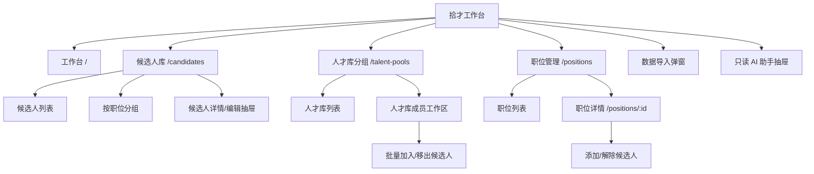

# 界面设计规范

## 0.2.0 人才检索视觉与交互增量（2026-09-10）

保持 Gemini/GPT 式输入框加结果：输入后直接检索，后台完成计划、过滤、召回、融合和重排。八个既有入口、导航顺序、候选人列表/按职位展示、现有 select 筛选、归档范围和业务功能均保留，不增加查询计划确认或必经步骤。

条件摘要默认折叠，证据可按需展开；加载、取消、重试、空结果、降级、索引变化和结果完整性提示均服务于当前结果。旧请求通过 AbortController 和请求序号隔离，重试时保留旧结果并明确标示状态。相似度只用于排序，不展示为能力百分比；关联职位/人才库不能冒充本人能力证据。

本次调整字体、间距、按钮、对齐、长文本换行和容器滚动，并修复 768px 菜单断点、移动端顶部间距以及检索/附件页标题遮挡。没有删除组件；正常弹窗、折叠、标签页、无障碍元素与响应式隐藏组件均保留。1440×900、768×1024、390×844 匿名验收 69/69 通过，范围和截图见 [检索界面验收](evidence/search-ui-acceptance.md)。

## 1. 设计目标

当前产品是“候选人资料管理 + 人才检索 + 人才库分组 + 职位关联”工作台，不是完整 ATS。界面服务于高频资料整理和长期人才沉淀，要求：

- 第一次使用即可分辨候选人、人才库分组和职位三个核心对象。
- 搜索、筛选、导入、编辑、关联、归档、恢复和受控永久删除均有明确入口和真实后端结果。
- 重要信息适合快速扫描，完整履历、历史评估和敏感来源资料按层级展开。
- 不用招聘流程状态替代人才画像，也不把申请记录数显示成候选人数。

“精致”来自稳定版式、清楚层级、完整状态和克制微交互，不来自营销 Hero、渐变背景、霓虹、装饰光斑或大面积插画。

## 2. 产品边界

- 候选人是核心档案；人才库是长期分组；职位是筛选、归类和资料关联实体。
- 候选人可以同时加入多个人才库，也可以关联多个职位。视觉重复不产生重复候选人数据。
- “当前职位”表示候选人当前任职；平台职位统一称为“关联职位”或“招聘职位”。
- 本阶段不提供面试排期、面试管道、Offer、审批或入职流程操作；候选人档案允许维护来源入职状态、入职日期和入职职位，但不提供流程推进、审批或状态机。
- 导入向导把“入职职位”显示为候选人事实字段；北森“最后职位类投递的职位id”单独显示为关联职位来源字段。两者不会互相填充，空关联职位值不会生成职位卡片或关系；专用表头存在时该行空值不回退普通 `职位编号`，仅整表没有该表头时才允许兼容回退。
- 历史评估和历史流程资料可以保留在候选人档案中，但只作为来源资料，不恢复为流程工作台。
- Agent 入口保留，并显示“全量只读”；它可以按用户问题查询敏感字段和旧阶段，但没有任何写入能力。

## 3. 默认信息架构

侧栏顺序为“工作台、候选人库、人才库分组、职位管理”，其后是“数据导入”和“AI 助手”两个全局动作。顶部继续保留低干扰的 AI 助手入口。

## 4. 招聘阶段兼容策略

`candidates.stage` 及相关类型保留用于历史数据兼容，但不进入默认人才库界面：

- 工作台不展示阶段分布。
- 候选人库不展示阶段筛选、阶段列或阶段看板入口。
- 候选人表单和详情不展示或修改阶段。
- 职位详情的候选人列表不展示阶段。
- 导入向导不提供阶段字段映射。
- AI 助手快捷问题和默认文案不使用阶段或面试流程语境。

遗留 `PipelineBoard` 和阶段样式组件可以继续存在于代码中作为兼容实现，但没有默认路由或可见入口，不得重新接入人才库主路径。

## 5. 飞书公开参考与借鉴边界

以下官方公开资料均于 **2026-08-05** 核验可访问：

- [飞书招聘：人才库运营](https://hire.feishu.cn/feature/tp)：公开产品图可核验人才库侧栏、搜索框、可移除筛选条件、高密度候选人摘要和头像/标签层级。
- [飞书招聘：招聘流程管理](https://hire.feishu.cn/feature/rp)：用于核验职位、候选人和批量操作的整体信息架构；本项目不引入其完整招聘流程。
- [飞书招聘 HR 入门手册](https://www.feishu.cn/hc/zh-CN/articles/381040174542-%E9%A3%9E%E4%B9%A6%E6%8B%9B%E8%81%98-hr-%E5%85%A5%E9%97%A8%E6%89%8B%E5%86%8C)：用于核验“职位与人才匹配、沉淀人才数据”的产品语义。
- [飞书 People 产品页](https://www.feishu.cn/product/people) 与 [一文读懂飞书 People](https://www.feishu.cn/hc/zh-CN/articles/536403642699-%E4%B8%80%E6%96%87%E8%AF%BB%E6%87%82%E9%A3%9E%E4%B9%A6people)：用于核验 People 的整体视觉方向和产品边界。
- [飞书招聘常见使用问题](https://www.feishu.cn/hc/zh-CN/articles/355896296441-%E9%A3%9E%E4%B9%A6%E6%8B%9B%E8%81%98%E5%B8%B8%E8%A7%81%E4%BD%BF%E7%94%A8%E9%97%AE%E9%A2%98)：官方说明“无职位”候选人需要手动分配职位或加入人才库，支持本项目保留“未分配职位”分组。
- [飞书 People 行为审计](https://www.feishu.cn/hc/zh-CN/articles/589375738598-%E7%AE%A1%E7%90%86%E5%91%98%E8%BF%9B%E8%A1%8C-people-%E8%A1%8C%E4%B8%BA%E5%AE%A1%E8%AE%A1)：用于区分成熟多人产品的审计能力与当前个人版最小删除审计。

本项目采用的主操作蓝为 `#3370FF`、按下/深色蓝为 `#245BDB`、主文字为 `#1F2329`；飞书人才库公开产品图可核验浅灰导航、浅蓝选中态、搜索与筛选胶囊、高密度列表及分栏详情。当前实现借鉴这些原则，但不复制飞书 Logo、品牌资产、专有文案或像素布局。

未找到可靠公开材料展示飞书招聘的永久删除确认弹窗，相关交互标记为**待验证**。本项目的一次确认弹窗、服务端预览令牌、数据范围说明和备份/来源系统边界来自自身安全要求，不能描述为飞书原样交互。

## 6. 视觉系统

### 6.1 基础变量

核心变量定义在 `src/styles.css`：

| 用途 | 变量 | 值 |
| --- | --- | --- |
| 主文字 | `--ink` | `#1f2329` |
| 次级文字 | `--muted` | `#646a73` |
| 分隔线 | `--line` | `#dee0e3` |
| 主表面 | `--surface` | `#ffffff` |
| 次表面 | `--surface-soft` | `#f8f9fb` |
| 页面背景 | `--canvas` | `#f5f6f8` |
| 主操作 | `--primary` | `#3370ff` |
| 主操作按下 | `--primary-active` | `#245bdb` |
| 信息色 | `--blue` | `#3370ff` |
| 警告色 | `--amber` | `#b26b00` |
| 成功色 | `--green` | `#2d8a5f` |
| 危险色 | `--red` | `#d54941` |
| 焦点色 | `--focus` | `#3370ff` |

字体栈为 `Inter, Segoe UI, PingFang SC, Microsoft YaHei, sans-serif`。文字 `letter-spacing: 0`，字号不随视口宽度缩放。

### 6.2 形状与层级

- 控件和业务容器使用 4 至 8px 圆角，卡片圆角不超过 8px。
- 主要依靠 1px 边框、浅色分区和留白建立层级。
- 阴影仅用于抽屉、弹窗、浮层和明确悬浮关系。
- 页面区段不做成悬浮卡片，禁止卡片嵌套卡片。
- 人才库使用小型颜色标识区分分组，颜色不是唯一识别手段，名称和人数必须同时出现。
- 职位状态和归档状态必须显示文字，不只依赖颜色。

## 7. 应用框架与工作台

桌面端采用固定侧栏、顶部栏和主内容区：

- 宽屏侧栏展开时为 224px；桌面可通过 `PanelLeftClose` / `PanelLeftOpen` 图标按钮收起为稳定的 72px 图标栏，主内容使用同一布局变量同步重排。
- 展开状态显示品牌名、导航文字和本地工作区说明；收起状态保留品牌图标、导航图标、当前路由选中态和 Agent 在线状态，并用 Tooltip、`title` 与准确的 `aria-label` 说明用途。
- 桌面收起偏好写入 `localStorage`；读取或写入异常时安全回退到展开状态。收起按钮支持键盘操作。
- 900px 以下侧栏改为覆盖式导航，并提供遮罩和关闭按钮。
- 移动端不显示桌面收起按钮，也不读取桌面收起状态来隐藏导航内容。
- 顶部显示当前页面名称、人才资料管理语境和 AI 助手入口。
- 主内容充分利用横向空间，宽表格只在自身容器滚动。

工作台展示真实后端数据：

- 在库人才数、人才库分组数、招聘中职位数和未分组人才数。
- 人才库分布和有效来源分布。
- 最近更新职位和最近更新候选人。
- 新增候选人、新增职位和导入候选人的快捷操作。

未分组人才统计进入带“未加入人才库”筛选的候选人列表，不再进入阶段看板。

## 8. 候选人库

### 8.1 工具区和筛选

候选人库提供：

- 姓名、公司、职位、学校和标签搜索；默认搜索不使用手机号、邮箱等敏感字段。
- 人才库、关联职位、最高学历、学校、专业、求职状态、有效来源、人才负责人、标签和档案状态筛选。
- 最近更新、最近创建、姓名和工作年限排序。
- 列表视图和按职位分组视图。
- 新增、导入、导出和批量关联职位。

有效筛选以可移除标签展示，并支持一键清除。人才库筛选支持“未加入人才库”，职位筛选支持“未分配职位”。

### 8.2 默认列表

桌面固定列为：

1. 选择。
2. 候选人摘要。
3. 当前经历。
4. 关联职位。
5. 人才库。
6. 所在地与学历摘要。
7. 标签。
8. 更新时间。
9. 行操作。

列表接口默认不返回完整联系方式或原始 `photo_url`。候选人摘要只显示脱敏值，未加载时显示“联系方式受保护”；`has_photo=true` 时统一头像组件通过受控端点加载证件照，否则显示姓名首字母。来源、负责人、学历、学校、专业和求职状态通过筛选或详情查看，不继续扩大主表宽度。

表头、列宽和动态标签区域必须稳定。表格使用自身横向与纵向滚动容器承载固定表头，页面根节点不得横向溢出。移动端使用同一候选人对象渲染紧凑条目，不维护另一套假数据。

工作台最近候选人、候选人列表桌面/移动项、按职位分组、候选人详情、职位详情和候选人选择器均使用同一个 `CandidateAvatar`。默认尺寸为 32px，详情为 52px；图片覆盖首字母但不改变容器尺寸。列表图片延迟加载，详情图片立即加载；图片请求失败时自动移除图片层并保留首字母，不能显示破图图标或引发布局跳动。

### 8.3 按职位分组

- 每个有当前筛选结果的职位显示候选人数并支持折叠。
- 未关联职位的候选人进入“未分配职位”。
- 一个候选人关联多个职位时可在多个组中显示，但始终使用同一候选人 ID。
- 分组行显示人才库或有效来源摘要，不显示招聘阶段。
- 详情、编辑、归档、恢复和职位关联继续调用真实 API。

## 9. 人才库分组页

`/talent-pools` 是正式一级页面，采用左侧分组索引和右侧成员工作区：

- 左侧支持人才库搜索、使用中/已归档/全部切换、人数和更新时间展示。
- 右侧显示分组名称、说明、颜色、归档状态和真实成员列表。
- 活动分组支持单选、当前筛选结果当前页全选、取消选择、单条归档和最多 100 个批量归档；批量栏显示选中数量并在一次确认中说明分组可恢复、候选人不会被归档或删除。
- 已归档分组支持单选、当前页全选、单条/批量恢复，以及单条/最多 100 个批量永久删除；活动与归档分组不能混合执行同一批量操作。
- 永久删除确认弹窗显示分组数量、当前关系计数、将解除的关系和不可恢复说明，不要求输入确认词。删除只作用于分组容器及成员关系，候选人、职位、附件、备注、活动和履历保持完整。
- 支持从现有候选人中批量加入，并排除已在当前人才库中的成员。
- 支持单选或多选后批量移出当前人才库。
- 加入或移出只改变分组关系，不删除候选人、不改变职位关联。
- 归档人才库不归档候选人，确认弹窗必须明确这一点。

桌面端为双栏工作区；900px 以下变为上下布局，人才库索引横向滚动；390px 视口中操作按钮允许换行，成员使用移动候选人条目。

## 10. 候选人详情与编辑

### 10.1 五个详情页签

候选人详情使用宽侧抽屉，身份区使用统一的大号证件照头像或首字母回退，并分为五个页签：

1. **档案**：基本资料、联系方式、当前经历、教育摘要、自我评价、求职偏好、入职信息（`hire_status` / `hire_date` / `hire_position`）、关联职位、人才库、有效来源和人才负责人。
2. **履历**：工作、教育、项目、实习、技能、语言、证书等 `profile_sections`，保留原文并可折叠查看结构化字段。
3. **历史评估**：展示评估类型、状态、结论、时间和分数；明确其只是历史资料，不形成面试流程看板。
4. **备注与动态**：新增备注和真实活动时间线。
5. **高级信息**：数据血缘、来源历史、职位申请来源、隐私授权记录及敏感原始字段。

原始 `raw_payload` 不在默认视图大段倾倒。只有资料已安全加载时才提供折叠字段表，字段值允许换行并限制在抽屉内。

### 10.2 敏感信息加载

- 默认候选人详情请求不包含手机号、邮箱、原始 `photo_url`、期望薪资、源记录 ID 和各类原始敏感载荷，只接收 `has_photo`。
- “查看敏感资料”是明确操作，调用 `GET /api/candidates/:id?include_sensitive=true`。
- 进入编辑同样属于明确操作，编辑表单显示前先加载完整详情。
- 敏感详情只保存在当前详情会话状态中，不回写到候选人全局列表，也不进入列表搜索。
- 高级信息区域使用警告色边界和隐私说明，但不使用夸张警告页面。
- 列表和默认筛选不读取敏感字段或历史流程原始载荷；AI 助手依据用户问题通过全量只读层按需读取，界面必须提示敏感内容可能发送到已配置模型网关。
- 头像图片经 `/api/candidates/:id/avatar` 获取，服务端只允许 HTTP/HTTPS 协议且路径以 `.jpg`、`.jpeg`、`.png` 或 `.webp` 结尾的地址（签名查询参数可保留），并以 private cache、no-referrer 的 `302` 跳转。该显示是用户对旧“照片默认不展示”规则的定向变更，不代表原始 URL 可以进入列表状态、日志或默认导出；Agent 仅在问题确实需要时经全字段只读层读取。

### 10.3 编辑表单

候选人表单按以下模块分区：

- 基本资料：姓名、所在地、联系方式和自我评价。
- 当前经历：公司、职位、工作年限和简历更新日期。
- 教育与能力：学历、学校和专业。
- 求职偏好：求职状态、期望职位、地点、工作性质、薪资和到岗时间。
- 入职信息：入职状态、入职日期和入职职位；只记录来源事实，不驱动流程状态机。有效日期没有状态时显示精确值“不确定”；三项全空时不渲染该区块，但候选人档案仍正常显示。
- 人才管理：有效来源、人才负责人和标签。

阶段字段不出现在表单中，也不会因为编辑人才档案而被静默覆盖。求职偏好通过专用业务 API 保存。

### 10.4 归档与危险操作

- 活动候选人的列表、移动条目和详情提供带 `Archive` 图标的归档入口。单条归档不使用阻断弹窗，成功 Toast 提供“撤销”。
- 多选后出现固定在数据工作区底部的批量操作栏；活动候选人可批量归档，归档候选人可批量永久删除，二者不得混合执行，单批最多 100 人。
- “在库候选人 / 已归档 / 全部档案”使用页签和数量徽标区分，归档记录在默认视图消失，在已归档视图可恢复。
- 已归档详情隐藏编辑、备注和关系操作，只显示恢复及危险区域。恢复使用 `RotateCcw` 与普通操作色，永久删除使用 `Trash2` 与危险红色，不能只靠颜色区分。
- “已归档”和“全部档案”都允许勾选已归档候选人；表头全选只作用于当前页可执行同一操作的记录。列表中的永久删除不得与恢复并列成普通快捷图标；详情抽屉底部可保留带文字的危险入口。
- 永久删除弹窗使用 `alertdialog`，展示主档、联系方式/照片 URL、备注/活动、职位/人才库关系、画像/偏好/来源/评估/授权等删除范围，并说明不会删除来源系统或历史备份。
- 弹窗打开后先调用服务端预览，展示候选人数、附件/职位/人才库关系数量、令牌有效期和不可恢复边界；不提供确认词输入框。用户点击一次“确认永久删除”提交 token。并发版本、归档状态、令牌过期或重放冲突必须刷新并要求重新预览。

## 11. 职位管理

职位列表、表单和详情继续保留：

- 搜索、状态、部门、负责人、地点和归档筛选。
- 名称、计划人数、关联候选人数、状态和更新时间。
- 添加已有候选人、新建并关联、单条或批量解除、按职位导出。
- 编辑、归档和恢复。
- 活动职位支持单选、当前筛选结果当前页全选、取消选择和最多 100 个批量归档。选中后出现批量操作栏；确认弹窗说明可在“已归档职位”恢复且不会删除候选人。
- 已归档职位继续支持单选、当前页全选和最多 100 个批量永久删除；活动与归档职位不能混合执行同一种批量操作。

职位详情候选人表格展示候选人、当前经历、人才库、负责人和更新时间，不展示招聘阶段。解除关联必须明确候选人档案仍保留；职位归档不删除候选人关系和历史记录。

职位永久删除复用同一弹窗骨架但使用独立影响文案：展示职位数、受影响候选人数、将删除的职位主记录/关系/从属记录，以及候选人、人才库、附件和备注保持完整。提交成功后刷新职位、候选人详情和统计；受影响候选人的活动时间线应显示“关联职位已永久删除”。

## 12. 简历附件与更新预览

AI 助手抽屉和候选人详情都提供真实附件上传入口，支持文件选择和拖放。上传区接受 PDF、DOCX、XLSX、XLSM、XLS、UTF-8 CSV 和 TXT，明确 15 MB 上限；只显示服务端返回的解析状态，不使用假进度。

附件工作流至少包含：

- 上传/解析中、解析完成、解析失败、过期/取消状态；错误信息可换行并保持在容器内。
- 每个 PDF/DOCX 一条候选记录，每个表格数据行一条记录；展示标准化手机号/邮箱、匹配状态、候选人摘要和阻断原因。
- `identity_conflict`、多候选命中或归档候选人用阻断样式；无匹配时提供候选人手工选择器，不提供“自动新建”。
- 字段建议逐项展示“当前值 -> 建议值”、置信度和来源证据，并使用复选框选择。默认只选择当前为空且非低置信字段；覆盖非空字段由用户显式勾选。
- 履历区块单独选择；默认“去重合并”，整体替换必须有独立确认控件。
- 底部确认栏显示已选记录、字段和区块数量；只有候选人已确认且预览有效时才能调用“确认更新并保存附件”。

预览确认、取消或过期后，界面不得继续展示缓存的正文或字段建议；服务端已擦除临时正文与记录 JSON，用户需要重新上传才能再次预览。模型建议失败时展示本地规则建议和真实网关状态，不伪造 AI 进度，也不跳过人工选择。

候选人详情“履历”页签增加“简历附件”区域，展示文件名、MIME/格式、大小、解析状态、上传时间和受控下载按钮。长文件名省略但可通过 `title` 查看，不能撑破抽屉或移动条目。归档候选人只允许查看/下载既有附件，不允许上传或确认更新。

履历搜索结果展示候选人、匹配分数、命中字段、最多必要数量的高亮证据片段和匹配依据。证据片段最多多行截断，分页继续搜索不会重置当前结构化条件。

## 13. 导入向导

普通 `.xlsx`、`.xlsm`、未加密 BIFF8 `.xls` 和 UTF-8 `.csv` 继续使用“上传、字段映射、数据预览、导入结果”四步向导。阶段字段已从可映射字段中移除，新增学校、专业、求职状态、入职状态、入职日期、入职职位、简历更新时间、自我评价及招聘职位名称/编号/部门/地点/负责人/来源映射。

只要用户显式映射招聘职位字段，通用导入也必须展示职位处理预览。职位名称、部门、地点和负责人应与候选人的 `current_title`、当前公司等字段在选项和表格上清楚区分。

北森人才档案预览需要额外区分：

- 候选人档案数。
- 申请来源记录数。
- 关联职位数（北森使用“最后职位类投递的职位id”，不使用“入职职位”）。
- 缺少身份的记录数。
- 已匹配职位数和预览新建职位数。
- 歧义职位、无效职位、归档职位冲突及拟新增关系数。

当工作簿含“最后职位类投递的职位id”专用表头时，该列是整表唯一权威关系键；单行为空时界面必须显示跳过关系，不能以普通 `职位编号`、职位名称或入职职位猜测。仅整表不含该表头时，才允许显示普通职位编号的兼容回退。

申请来源记录不得显示成新增候选人。预览“候选人档案数”是观察到的唯一 ID 数，提交结果的 `candidate_count` 才是成功处理的唯一候选人数；导入、更新、跳过和失败行数必须能与总行数核对。缺少 `应聘者ID` 的记录必须明确提示不会创建或更新候选人；新 ID 缺姓名时提示阻断，已有 ID 则允许省略姓名进行增量补充。

`申请ID` 和职位信息在表头及预览中标记为可选。完全没有招聘职位字段时展示“跳过关系”；显式职位字段若无效、匹配歧义或命中归档职位，受影响源行必须显示失败原因并阻断该行候选人、职位、关系和来源载荷写入。只有可建立职位关系或存在真实评估载荷时，申请 ID 才参与重复/归属校验；其他未使用信息只跳过。申请归属冲突必须明确显示“不会改绑”。失败行不得出现在候选人、职位或来源载荷成功统计中。

文件选择器接受 `.xlsx`、`.xlsm`、`.xls` 和 `.csv`。`.xls` 的 OLE2/BIFF8 校验由服务端完成；伪装扩展名、加密或非 BIFF8 文件的错误必须原样清楚反馈，不能尝试在浏览器端猜测或转换。

职位预览条目使用文字状态“匹配 / 新建草稿 / 歧义 / 无效 / 归档冲突”，颜色只用于辅助；歧义和归档冲突必须显示原因并阻断静默创建。预览只读，不得在此阶段提前创建职位。

## 14. AI 助手

AI 助手入口同时保留在侧栏和顶部栏，使用右侧抽屉：

- 明确显示“全量只读”，并说明敏感查询和附件文本可能发送到已配置模型网关。
- V8 聊天使用本机 SQLite 持久会话。抽屉打开时恢复 `localStorage` 中符合 UUID 格式的活动会话 ID；ID 无效、会话不存在或已归档时回退到活动会话列表，不从浏览器缓存恢复正文。
- 标题区提供历史会话和新建会话图标按钮。历史面板按更新时间分页列出活动会话，支持选择、1-200 字符重命名和一次确认后的永久删除；删除文案明确只删除本机会话、消息和摘要，不影响候选人或其他业务数据。
- 当前抽屉不展示归档会话或归档/恢复按钮；归档/恢复属于已实现的会话 API 能力。界面如果后续接入，必须将归档与永久删除继续分开，归档会话不得发送消息。
- 每次先加载最新 50 条消息；存在更早记录时在消息区顶部显示“加载更早消息”，按 `before_sequence` 游标向前追加并保持现有消息顺序。切换会话会取消上一会话的在途读取，避免串写布局。
- 发送时使用客户端随机 `client_request_id` 和一条临时用户消息；服务端返回持久记录后按消息 ID/序号合并，幂等重放不复制用户消息或 Agent 回复。处理中重放显示可恢复状态，失败后重新读取 SQLite 中的真实消息状态。
- `localStorage` 只保存不透明活动会话 UUID 与历史面板开关，不保存消息、摘要、手机号、邮箱、薪资、简历或工具结果；存储不可用时安全回退到无浏览器偏好，SQLite 仍是事实来源。
- 快捷查询覆盖人才档案、人才库、职位、完整履历和附件；结果使用分页、聚合或 Top-K 证据，不把整个数据库放入抽屉或模型上下文。
- 可以通过受控工具执行单条只读 SQL，但不向普通用户暴露通用终端或任何写入入口。
- 敏感字段按明确问题返回未打码真实值；不得继续显示“无权限”或强制掩码。
- 只有 Agent 回复使用安全 Markdown/GFM 渲染，支持抽屉尺度的标题、段落、粗体/斜体、列表、引用、分隔线、链接、行内代码、代码块和表格；用户消息保持原有纯文本展示。
- 不启用 raw HTML；脚本、事件属性、危险 URL 和远程 Markdown 图片不得执行或加载。外部链接在新窗口安全打开并设置 `noopener noreferrer`。
- 流式或异步状态只更新当前消息内容，不复制消息节点；代码块和宽表格在消息容器内独立横向滚动，标题字号不得达到页面 Hero 级别。
- 抽屉内嵌附件上传、解析/匹配结果和字段预览，但 Agent 自身不能点击或调用确认更新 API，最终保存必须由用户操作。
- 未配置时显示可理解的不可用状态，不影响其他页面使用。

## 15. 交互状态

每个数据界面必须覆盖：

- 初次加载、局部加载和 Skeleton。
- 空数据库、无筛选结果、空人才库和全部已关联。
- 服务端校验、网络错误和操作冲突。
- 头像无照片、远程地址过期、断网或图片加载失败时保持固定尺寸并回退姓名首字母，不弹出全局错误 Toast。
- 成功 Toast、按钮忙碌和重复提交禁用。
- 单条归档成功 Toast 与撤销；批量归档人数确认；恢复结果反馈；永久删除只显示一次清晰确认弹窗，并由服务端一次性 token 提供第二层保护。
- 附件拖入、解析、身份冲突、候选人手工选择、字段勾选、确认、重复附件和清理失败状态。
- 解除关系和批量移出的明确确认或结果提示。
- 悬停、选中、禁用和键盘焦点状态。

过渡时长以 100 至 180ms 为主，并遵循 `prefers-reduced-motion`。

## 16. 响应式与无障碍

重点验收视口：

- 桌面：1440x900。
- 移动：390x844。

实现要求：

- 页面根节点无横向滚动，宽表格只在自身容器滚动。
- 720px 以下候选人和职位表格切换为移动条目。
- 人才库双栏在 900px 以下变成上下布局，分组索引自身横向滚动。
- 桌面侧栏收起只在 901px 及以上生效；390px 移动视口仍使用完整覆盖式导航。
- 抽屉在移动端占满宽度；弹窗不超过视口并保留安全区内边距。
- 表单在 480px 以下改为单列。
- 长姓名、人才库名称、职位名称、邮箱、标签和原始字段不得撑破容器。
- 移动选择和行操作至少提供 36px 点击区域。
- 图标按钮具有 `aria-label` 和 Tooltip；表单有可见标签。
- 焦点轮廓使用 2px `var(--focus)`，状态不能只依赖颜色。

## 17. 当前实现与验收状态

- 默认信息架构、人才库分组页、候选人筛选、五页签详情、敏感加载、职位详情去阶段、统一 `CandidateAvatar`、候选人归档页签、批量操作栏、永久删除确认和职位导入预览已在前端代码中实现。
- V6.1 前端代码已接入活动职位批量归档、人才库分组单条/批量生命周期操作、Agent 安全 Markdown 渲染和桌面侧栏收起；本轮桌面/移动最终浏览器门禁与截图路径以 `docs/TESTING.md` 的 V6.1 收尾记录为准。
- V8 前端代码已接入持久活动会话、历史面板、新建/重命名/删除、`before_sequence` 加载更早消息、请求幂等 ID 和刷新后会话恢复；Agent 回复继续复用安全 Markdown 渲染。相关静态 UI/契约自动化已包含在当前 141/141 测试中。
- 视觉基线已从绿色主导改为冷白、浅灰、石墨文字与克制蓝色主操作；绿色只承担成功/在线等状态或用户自定义人才库色标，不作为全局主色。
- V6 完整后端套件 78/78、附件定向 10/10、安全定向 2/2，TypeScript、生产构建、18 个服务端文件语法和低级别依赖审计通过；正式 V6 加法迁移及只读核对已完成。最终 1440x900/390x844 Playwright 复验修复了 `.bulk-action-bar` 负 margin 导致的移动端遮挡，两种视口根节点宽度等于 viewport，控制台 0 error、0 warning；候选人/职位删除预览连接真实 API，未在正式库提交永久删除。截图见 `output/playwright/final-v6-security-20260805/desktop-1440x900-fixed.png` 和 `output/playwright/final-v6-security-20260805/mobile-390x844-fixed.png`，完整记录见 `docs/TESTING.md`。
- 当前照片是带签名参数的远程明文 HTTP 资源，不是离线附件。个人回环版按需联网；部门部署前必须完成认证/RBAC和受控本地或内部附件迁移。
- V12 的表单、抽屉和导入语义已实现并有隔离验证；100 人 `:memory:` 结果仍为 `formal_database_commit=false`。2026-08-24 已完成正式 HTTP 预览/提交（100 条更新、无新增/失败/跳过），但用户豁免全库摘要、逐行字段后检、完整性/外键后检和恢复演练；界面验收不据此声称正式库后检完成。
- V8 已在匿名独立服务完成 1440x900/390x844 浏览器验收：候选人和人才库成员均为 20 条/页、45 条共 3 页，桌面页内全选在翻页后清空；Agent 刷新后恢复 4 条消息并保持跨轮上下文；Unity 检索召回 45 条、每页 20 条，证据展示真实表/字段和 `<mark>` 高亮；桌面侧栏 72/224 px 切换并刷新保持，移动导航正常。两种视口控制台 0 error/0 warning，根节点无横向溢出；截图路径见 `docs/TESTING.md`。
